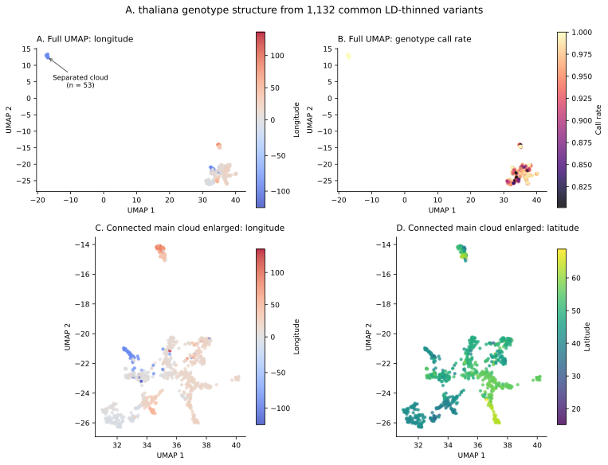
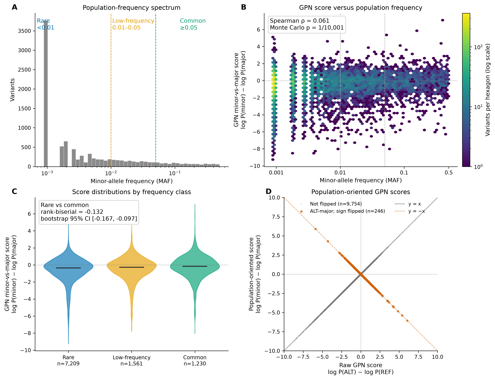
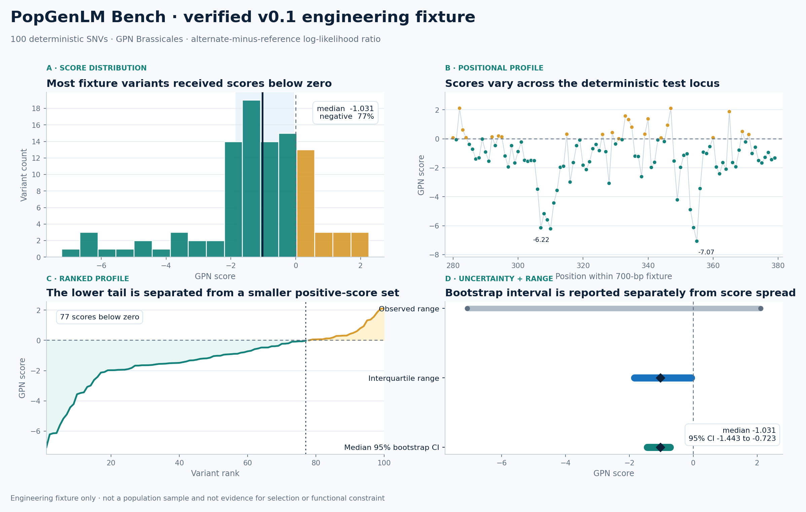

```{=html}
<style>
#v04-models table { display: block; max-width: 100%; overflow-x: auto; }
</style>
<section class="page-hero popgenlm-hero" aria-labelledby="popgenlm-title">
  <div class="eyebrow">Open-source scientific AI</div>
  <h1 id="popgenlm-title">PopGenLM Bench</h1>
  <p class="lead">I started PopGenLM Bench with 100 variants and a question I could test end to end: could I reproduce a genomic model’s scores and trace them back to the right alleles? Each release added a harder test. In v0.4, I ask whether adding a model score changes which linked variants I would follow up at an Arabidopsis expression locus.</p>
  <p class="hero-support">The benchmark brings my population-genetics experience into the software itself, through reference checks, explicit score definitions, matched comparisons, and reproducible reports. Follow the learning story in <a href="genomes-to-ai.html">Genomes to AI</a>.</p>
  <div class="tag-row">
    <span class="status-badge blue">v0.4.0 · latest release</span>
    <span class="tag">Seven evidence sources</span><span class="tag">Population genomics</span><span class="tag">Scientific AI engineering</span><span class="tag">Apache-2.0 code · source-specific data terms</span>
  </div>
  <div class="hero-actions">
    <a class="button-primary" href="https://github.com/tahirali-biomics/popgenlm-bench/tree/v0.4.0">View the benchmark</a>
    <a class="button-secondary" href="https://colab.research.google.com/github/tahirali-biomics/popgenlm-bench/blob/v0.4.0/notebooks/v0.4/popgenlm-v04-overview.ipynb">Reproduce in Colab</a>
    <a class="button-secondary" href="https://github.com/tahirali-biomics/popgenlm-bench/releases/tag/v0.4.0">Read the release</a>
  </div>
</section>
```

## v0.4.0 — Regulatory Variant Prioritization Pilot {#v04}

v0.4 adds frozen discovery/holdout inputs, restartable model scoring, candidate-matched comparisons, and a shared CPU reproduction path. I can now inspect how a model changes the shortlist at an expression locus, including the variants it displaces. The endpoint is **held-out association-signal recovery** in the same study—not independent causal-nucleotide validation. **Causal-SNP recovery remains unestimable: zero eligible loci.**

```{=html}
<figure class="benchmark-figure popgenlm-release-figure">
  
  <figcaption><strong>Paired ranks before the headline percentage.</strong> PlantCAD2-S at 512 bp recovers 18/34 held-out signals versus 17/34 for the annotation baseline, with two gains and one loss. Comparisons use identical candidates and loci. AlphaGenome’s four-locus denominator stays separate. <strong>PopGenLM adaptation from cached inference</strong>, not a source-data redraw or inference rerun. Models and original methods are cited <a href="#v04-references">below</a>. <a href="https://raw.githubusercontent.com/tahirali-biomics/popgenlm-bench/v0.4.0/figures/v0.4/benchmark.svg">Open SVG</a> · <a href="https://raw.githubusercontent.com/tahirali-biomics/popgenlm-bench/v0.4.0/figures/v0.4/benchmark.png">Download PNG</a></figcaption>
</figure>
```

| Magnitude rule | Held-out signals: model vs matched baseline | Top-five gains / losses |
|---|---|---|
| PlantCAD2-S · 512 bp | **18/34 versus 17/34** | 2 / 1 |
| PlantCAD2-S · 4 kb | 18/34 versus 17/34 | 3 / 2 |
| Botanic1-S · 512 bp | 17/34 versus 17/34 | 1 / 1 |
| Botanic1-S · 4 kb | **19/34 versus 17/34** | **3 / 1** |
| GPN Brassicales · 512 bp | 17/34 versus 17/34 | 1 / 1 |
| Original PlantCAD · l32 · 512 bp | 17/34 versus 17/34 | 1 / 1 |
| nemo · *B. napus* transfer | **8/14 versus 8/14** | 0 / 0 |
| AlphaGenome · mammalian-to-plant transfer | **2/4 versus 1/4** | 1 / 0 |

Signed PlantCAD2-S (22/34 versus 17/34) and signed Botanic1-S (21/34 versus 17/34) were explored on the original loci and remain **exploratory**. No fitted weights or confirmatory causal claim is made. The chromosome-block uncertainty is descriptive, with only five blocks on the full panel and two on the AlphaGenome subset. [Exact metrics and protocol](https://github.com/tahirali-biomics/popgenlm-bench/blob/v0.4.0/docs/v0.4_release.md).

### A shortlist gain—and the SNP that leaves {#v04-worked-locus}

```{=html}
<figure class="benchmark-figure popgenlm-release-figure">
  
  <figcaption><strong>AT1G01690.</strong> PlantCAD2-S moves the held-out association target <code>1:249256:T:C</code> from rank 6 to4; <code>1:247721:C:T</code> leaves the shortlist, rank 3 to6. A gene model, association evidence, LD, site conservation and model outputs share a TAIR10.1 axis. <strong>PopGenLM adaptation</strong> from frozen <a href="#v04-references">1001 Genomes, TAIR10.1, GSE80744 and model evidence</a>; the association target is a proxy, not causal truth. <a href="https://raw.githubusercontent.com/tahirali-biomics/popgenlm-bench/v0.4.0/figures/v0.4/AT1G01690_shortlist_changes.tsv">Exact membership</a> · <a href="https://raw.githubusercontent.com/tahirali-biomics/popgenlm-bench/v0.4.0/figures/v0.4/locus_AT1G01690.svg">Open SVG</a> · <a href="https://raw.githubusercontent.com/tahirali-biomics/popgenlm-bench/v0.4.0/figures/v0.4/locus_AT1G01690.png">Download PNG</a>.</figcaption>
</figure>
```

The package also shows the loss at [AT4G02405](https://raw.githubusercontent.com/tahirali-biomics/popgenlm-bench/v0.4.0/figures/v0.4/locus_AT4G02405.svg): its target moves from rank 3 to11. Showing both outcomes changed how I report the benchmark: a net gain of one signal does not mean every locus improves.

### Seven models and evidence sources {#v04-models}

Each figure reflects the method’s output. Exact checkpoint revisions, score units, strand handling, coverage and evaluation endpoints are in the [release evidence table](https://github.com/tahirali-biomics/popgenlm-bench/blob/v0.4.0/docs/v0.4_release.md#model-identity-and-evidence). Original raw outputs remain distinct from oriented/harmonized scores. **“Original PlantCAD-S” is a historical label: the verified checkpoint actually used is `kuleshov-group/PlantCaduceus_l32`, not a verified Small checkpoint.**

| Model / evidence | Role and candidate coverage | Figure · focused Colab |
|---|---|---|
| **PhyloP** | Site-level conservation reference; 1,195/1,205 covered, ten missing; never allele-oriented | [Figure](https://raw.githubusercontent.com/tahirali-biomics/popgenlm-bench/v0.4.0/figures/v0.4/phylop.svg) · [Colab](https://colab.research.google.com/github/tahirali-biomics/popgenlm-bench/blob/v0.4.0/notebooks/v0.4/popgenlm-v04-phylop.ipynb) |
| **GPN Brassicales** | 512-bp sequence likelihood; 1,205/1,205; v0.3 population evidence retained | [Figure](https://raw.githubusercontent.com/tahirali-biomics/popgenlm-bench/v0.4.0/figures/v0.4/gpn.svg) · [Colab](https://colab.research.google.com/github/tahirali-biomics/popgenlm-bench/blob/v0.4.0/notebooks/v0.4/popgenlm-v04-gpn.ipynb) |
| **Original PlantCAD-S / l32** | 512-bp sequence likelihood; 1,205/1,205; v0.3 evidence retained | [Figure](https://raw.githubusercontent.com/tahirali-biomics/popgenlm-bench/v0.4.0/figures/v0.4/plantcad.svg) · [Colab](https://colab.research.google.com/github/tahirali-biomics/popgenlm-bench/blob/v0.4.0/notebooks/v0.4/popgenlm-v04-plantcad.ipynb) |
| **PlantCAD2-S** | Context/likelihood comparison at 512 bp and 4 kb; 1,205/1,205 each | [Figure](https://raw.githubusercontent.com/tahirali-biomics/popgenlm-bench/v0.4.0/figures/v0.4/plantcad2.svg) · [Colab](https://colab.research.google.com/github/tahirali-biomics/popgenlm-bench/blob/v0.4.0/notebooks/v0.4/popgenlm-v04-plantcad2.ipynb) |
| **Botanic1-S** | Completed 512-bp/4-kb zero-shot comparison; 1,205/1,205 each; separate ATAC reproduction limited below | [Figure](https://raw.githubusercontent.com/tahirali-biomics/popgenlm-bench/v0.4.0/figures/v0.4/botanic.svg) · [Colab](https://colab.research.google.com/github/tahirali-biomics/popgenlm-bench/blob/v0.4.0/notebooks/v0.4/popgenlm-v04-botanic.ipynb) |
| **nemo** | Predicted expression delta; *B. napus* transfer, 507/1,205; native *A. thaliana* resources missing | [Figure](https://raw.githubusercontent.com/tahirali-biomics/popgenlm-bench/v0.4.0/figures/v0.4/nemo.svg) · [Colab](https://colab.research.google.com/github/tahirali-biomics/popgenlm-bench/blob/v0.4.0/notebooks/v0.4/popgenlm-v04-nemo.ipynb) |
| **AlphaGenome** | Mammalian-to-plant RNA-seq transfer; 194/1,205, five predefined loci, four evaluable | [Figure](https://raw.githubusercontent.com/tahirali-biomics/popgenlm-bench/v0.4.0/figures/v0.4/alphagenome.svg) · [Colab](https://colab.research.google.com/github/tahirali-biomics/popgenlm-bench/blob/v0.4.0/notebooks/v0.4/popgenlm-v04-alphagenome.ipynb) |

**Figure provenance and limits.** All are PopGenLM adaptations from cached evidence. AlphaGenome adapts **Avsec et al. Fig. 4b and 6b**: paired REF/ALT predictions and differences, with the focal SNP and gene model. Its display is human plus-strand neuronal stem-cell polyA RNA-seq track 0, API v1 `ALL_FOLDS`, SDK 0.11.0; ranking retains all 667 tracks. [Observed Arabidopsis expression by genotype](https://raw.githubusercontent.com/tahirali-biomics/popgenlm-bench/v0.4.0/figures/v0.4/observed_arabidopsis.svg) is a separate GSE80744 panel, not measured RNA-seq coverage or mammalian-track calibration. The four eligible AlphaGenome target-rank changes are AT3G23110:6→4, AT3G53880:47→41, AT4G14840:15→13, AT4G33940:1→2. AT2G22240 is illustrative and ineligible.

The nemo figure adapts the expression-contrast idea of **Rockenbach et al. Fig. 3a**, showing predicted ALT−REF expression changes by promoter/terminator position and the coverage-matched 8/14 versus8/14 result. It does not reproduce native Arabidopsis accuracy: family-safe native weights/folds, reconciled expression inputs and scalers remain missing. *B. napus* transfer and native *A. thaliana* nemo are not interchangeable.

Botanic’s Arabidopsis **ATAC-seq reproduction of Barozet et al., bioRxiv v3 Fig. 4b/4d remains separate and blocked**: verified accessibility measurements, held-out chromosome 4 peaks/labels/split, fine-tuned ATAC head or official predictions, and matched ChromBPNet outputs are unavailable. Full v3 caption access was blocked, so that panel correspondence is not independently verified. The completed zero-shot context comparison is not a substitute for accessibility prediction.

### Reproduce the public package {#v04-reproduction}

[**Overview Colab**](https://colab.research.google.com/github/tahirali-biomics/popgenlm-bench/blob/v0.4.0/notebooks/v0.4/popgenlm-v04-overview.ipynb) · [**Public CPU input bundle**](https://github.com/tahirali-biomics/popgenlm-bench/releases/download/v0.4.0/popgenlm-v04-public-inputs.zip) · [**Executed notebooks**](https://github.com/tahirali-biomics/popgenlm-bench/releases/download/v0.4.0/executed-notebooks.zip) · [**Download checksums**](https://github.com/tahirali-biomics/popgenlm-bench/releases/download/v0.4.0/SHA256SUMS.txt).

Eight notebooks passed in a clean local CPU environment, each with a fresh kernel and archive extraction. They verify pinned checksums, reconstruct the available score-based ranks, and check paired outcomes. **Local execution is distinct from hosted testing:** anonymous Colab previews are checked; no notebook is claimed to have run in a signed-in Google-hosted runtime.

Code is Apache-2.0; model outputs retain their own terms. Raw Botanic scores are excluded: its public notebook verifies published rank/count arithmetic and displays the frozen LLR/context figure, rather than reconstructing omitted raw scores. AlphaGenome reproduces cached-score ranks and the illustrative track, not every full 667-track API aggregation. [Exact reproduction scope, separately obtained inputs and provider notices](https://github.com/tahirali-biomics/popgenlm-bench/blob/v0.4.0/docs/v0.4_data_terms.md).

This work uses the Botanic™ model developed by Living Models, available under the Botanic™ Model License; research publication, as-is, with the modifications stated in the release. AlphaGenome outputs and derivatives are subject to its [Output Terms of Use](https://deepmind.google.com/science/alphagenome/output-terms). Neither provider’s outputs are relicensed as Apache data.

### What the engineering changed {#v04-engineering}

I froze the accession split and candidate set before scoring, retained raw allele/strand definitions, and required each model and baseline to rank the same SNPs. That decision prevents coverage differences from becoming apparent model gains. Restartable shards, reference checks, checksum-pinned inputs and one shared evaluation implementation make the result inspectable beyond RAMSES. The gain and loss loci make the biological consequence visible. The result justifies transparent follow-up shortlists and independent tests; it does not identify causal nucleotides.

Read the [v0.4 Genomes to AI release note](https://github.com/tahirali-biomics/popgenlm-bench/blob/v0.4.0/docs/v0.4_genomes_to_ai.md) alongside [my journal](genomes-to-ai.html).

### Citations and data sources {#v04-references}

- **GPN:** Benegas, Batra and Song (2023), *DNA language models are powerful predictors of genome-wide variant effects*. [10.1073/pnas.2311219120](https://pmc.ncbi.nlm.nih.gov/articles/PMC10622914/).
- **PlantCaduceus:** Zhai et al. (2025), *Cross-species modeling of plant genomes at single-nucleotide resolution using a pretrained DNA language model*. [10.1073/pnas.2421738122](https://pmc.ncbi.nlm.nih.gov/articles/PMC12184517/).
- **PlantCAD2:** Zhai et al. (2026), *PlantCAD2: A DNA foundation model for interpreting genomes across flowering plants*. [10.1016/j.xgen.2026.101329](https://pmc.ncbi.nlm.nih.gov/articles/PMC13576720/).
- **Botanic1:** Barozet et al. (2026), *BOTANIC-1*, bioRxiv **v3**. [10.64898/2026.09.04.749355](https://www.biorxiv.org/content/10.64898/2026.09.04.749355v3.full); separate requested ATAC panels4b/4d, limits above.
- **nemo:** Rockenbach et al. (2026), *A deep learning model captures position-specific effects of plant regulatory sequences and suggests genes under complex regulation*. [10.1093/plphys/kiag473](https://pubmed.ncbi.nlm.nih.gov/42413033/), Fig. 3a.
- **AlphaGenome:** Avsec et al. (2026), *Advancing regulatory variant effect prediction with AlphaGenome*. [10.1038/s41586-025-10014-0](https://pmc.ncbi.nlm.nih.gov/articles/PMC12851941/), Fig. 4b/6b.
- **PhyloP method:** Pollard et al. (2010), *Detection of nonneutral substitution rates on mammalian phylogenies*. [10.1101/gr.097857.109](https://pubmed.ncbi.nlm.nih.gov/19858363/). **Actual plant track:** PlantRegMap `Ath_PhyloP.bedGraph.gz`; Tian et al. (2020), [10.1093/nar/gkz1020](https://pubmed.ncbi.nlm.nih.gov/31701126/). [Track URL and exact hash](https://github.com/tahirali-biomics/popgenlm-bench/blob/v0.4.0/data/benchmarks/v0.4/acquisition.json).
- **Population/input validation:** 1001 Genomes Consortium (2016), [10.1016/j.cell.2016.05.063](https://pubmed.ncbi.nlm.nih.gov/27293186/); v3.1 genotype callset joined by accession and REF-checked against [NCBI TAIR10.1, GCF_000001735.4](https://www.ncbi.nlm.nih.gov/datasets/genome/GCF_000001735.4/).
- **Expression join:** [GSE80744](https://www.ncbi.nlm.nih.gov/geo/query/acc.cgi?acc=GSE80744), Kawakatsu et al. (2016), [10.1016/j.cell.2016.06.044](https://pubmed.ncbi.nlm.nih.gov/27419873/), processed normalized gene expression.
- **cis-eQTL/regulatory source and reporter audit:** Voichek et al. (2024), *Widespread position-dependent transcriptional regulatory sequences in plants*, [10.1038/s41588-024-01907-3](https://pubmed.ncbi.nlm.nih.gov/39266765/), [exact code deposit 13170729](https://zenodo.org/records/13170729). PopGenLM recomputes accession-split LOCO mapping; it does not claim an exact rerun of that study’s batch analysis.

## Why PopGenLM Bench is needed

<p class="lead">Producing a score is an inference step. Establishing what that score means is an evaluation problem.</p>

DNA language models learn statistical regularities from sequence context and can assign scores to large numbers of candidate variants. But a technically valid score is not automatically biological evidence. Before a score is interpreted, its coordinate system, alleles, reference sequence, model revision, orientation, provenance, statistical behaviour, and relationship to independent biological observations need to be checked.

Population and evolutionary genomics provide evidence against which model scores can be evaluated. PopGenLM Bench is designed as the reproducible layer between **model output** and **biological claim**: validate the inputs, preserve inference provenance, orient scores explicitly, quantify associations and uncertainty, and state what the result does — and does not — support.

```{=html}
<div class="validation-stack" aria-label="Validation layers">
  <article><span>01</span><div><h3>Input integrity</h3><p>Genome build, chromosome mapping, coordinates, REF/ALT alleles, duplicates, missingness, and sequence context.</p></div></article>
  <article><span>02</span><div><h3>Inference provenance</h3><p>Model revision, upstream code, packages, parameters, device, inputs, outputs, runtime, and hashes.</p></div></article>
  <article><span>03</span><div><h3>Population orientation</h3><p>Separate raw REF-to-ALT model scores from population minor-vs-major scores so the biological comparison is explicit.</p></div></article>
  <article><span>04</span><div><h3>Biological concordance</h3><p>Evaluate model concordance with allele frequency, conservation, and genomic context, while testing LD sensitivity and summarizing population structure.</p></div></article>
</div>
```

## v0.3.0 — Evolutionary evidence

v0.3.0 added the ability to integrate frozen model outputs with genomic annotations and LD-aware descriptive checks. It integrates population-oriented GPN and PlantCAD scores with evolutionary and genomic evidence for **10,000 real *Arabidopsis thaliana* population variants selected using a deterministic procedure.** The release is organized around a frozen **10,000 × 39 annotated master table**, with exclusive genomic-context annotations, signed site-oriented PhyloP conservation, fixed physical-bin and LD-sensitivity analyses, genotype-quality summaries, and UMAP population-structure summaries.

The v0.3 release assets are frozen and hash-verified. Its primary population score is `log P(minor allele) − log P(major allele)`. Raw model scores retain `log P(ALT) − log P(REF)`. PhyloP is **site-oriented, not allele-oriented**, so its sign is not treated as an allele preference.

### Validated descriptive results

- GPN–PlantCAD: Spearman ρ = **0.6525**, Pearson r = **0.6331**, *n* = **10,000**.
- GPN–PhyloP: Spearman ρ = **−0.1876**, *n* = **9,453**.
- GPN–PlantCAD remains approximately **0.6523–0.6534** across released LD profiles.
- Context-stratified GPN–PlantCAD Spearman correlations range from **0.5171** in coding CDS to **0.7349** in intergenic variants.

The sample-quality summaries contain **1,135 samples** in the sample-quality table, **1,093 samples** in the primary call-rate set, **996 samples** in the strict set, and geographic metadata for **1,131 samples**.

These are descriptive associations. They do not show that either model directly measures fitness, selection, causality, or pathogenicity. v0.3.0 claims no hypothesis-test *p*-values.

```{=html}
<figure class="benchmark-figure popgenlm-release-figure">
  
  <figcaption><strong>v0.3.0 model evidence.</strong> A: GPN–PlantCAD population-oriented concordance. B: physical-bin bootstrap intervals. C: concordance across genomic contexts. D: LD-thinning sensitivity. <a href="assets/popgenlm/v0.3/model_evidence.svg">Open SVG</a> · <a href="assets/popgenlm/v0.3/model_evidence.png">Download PNG</a></figcaption>
</figure>
<figure class="benchmark-figure popgenlm-release-figure">
  
  <figcaption><strong>v0.3.0 genotype structure and geography.</strong> A: full UMAP coloured by longitude. B: full UMAP coloured by genotype call rate. C: connected main cloud enlarged and coloured by longitude. D: connected main cloud enlarged and coloured by latitude. <a href="assets/popgenlm/v0.3/genotype_umap_geography.svg">Open SVG</a> · <a href="assets/popgenlm/v0.3/genotype_umap_geography.png">Download PNG</a></figcaption>
</figure>
```

```{=html}
<div class="link-row">
  <a class="button-primary" href="https://colab.research.google.com/github/tahirali-biomics/popgenlm-bench/blob/v0.3.0/notebooks/popgenlm-bench-v0.3.ipynb">Open v0.3.0 in Colab</a>
  <a class="button-secondary" href="https://github.com/tahirali-biomics/popgenlm-bench/blob/v0.3.0/docs/v0.3_release.md">Read full v0.3.0 documentation</a>
  <a class="button-secondary" href="https://github.com/tahirali-biomics/popgenlm-bench/releases/tag/v0.3.0">Release notes</a>
</div>
```

## v0.3.0 Colab — inspect the frozen release

The public notebook loads, verifies, summarizes, and displays the frozen v0.3.0 assets. It does not rerun PlantCAD/GPN inference, VCF processing, UMAP fitting, or bootstrap production analysis.

```{=html}
<div class="colab-panel"><div><div class="card-kicker">Active v0.3 reproducible notebook</div><h3>Frozen assets with transparent validation</h3><p>The notebook is pinned to v0.3.0 and checks the released files before loading the descriptive summaries and displaying the frozen figures.</p></div><a class="button-colab" href="https://colab.research.google.com/github/tahirali-biomics/popgenlm-bench/blob/v0.3.0/notebooks/popgenlm-bench-v0.3.ipynb">Open v0.3.0 in Google Colab</a></div>
```

## v0.2.0 — population-aware GPN benchmark

```{=html}
<section class="benchmark-summary" aria-label="PopGenLM Bench v0.2.0 summary">
  <div class="benchmark-copy">
    <div class="card-kicker">Active release · population-aware benchmark</div>
    <h3>10,000 real <em>Arabidopsis thaliana</em> variants</h3>
    <p>v0.2.0 added deterministic population sampling, exact reference validation and explicit minor-versus-major score orientation. It uses deterministically selected biallelic SNPs from the 1001 Genomes Project, validates every REF allele against TAIR10.1, combines population summaries with reproducible GPN Brassicales scores, and evaluates the relationship between minor-allele frequency and model score.</p>
  </div>
  <div class="stats-grid benchmark-stats">
    <div class="stat-card"><span class="stat-value">10,000</span><span class="stat-label">population variants</span></div>
    <div class="stat-card"><span class="stat-value">7,209</span><span class="stat-label">rare variants, MAF &lt; 0.01</span></div>
    <div class="stat-card"><span class="stat-value">ρ = 0.061</span><span class="stat-label">MAF × GPN association</span></div>
    <div class="stat-card"><span class="stat-value">−0.132</span><span class="stat-label">rare-vs-common rank-biserial effect</span></div>
  </div>
  <figure class="benchmark-figure">
    
    <figcaption>PopGenLM Bench v0.2.0. Rare variants dominate the benchmark, the MAF–score association is weak, frequency classes overlap substantially, and 246 ALT-major variants require a sign reversal when the raw REF-to-ALT GPN score is oriented as minor versus major.</figcaption>
  </figure>
</section>
```

The primary population-oriented score is `log P(minor) − log P(major)`. Negative values mean that GPN assigns lower sequence likelihood to the population minor allele than to the major allele.

For variants in which ALT is the minor allele, the raw score `log P(ALT) − log P(REF)` already has the required orientation. For the **246 ALT-major variants**, the sign is reversed. This transformation makes the population comparison explicit; it does not create the observed genome-wide association.

### Main result

Across the 10,000-variant benchmark:

- **Spearman ρ = 0.0611** between MAF and the GPN minor-vs-major score;
- chromosome-stratified **Monte Carlo p = 1 / 10,001**;
- rare variants have median score **−0.3485**;
- common variants have median score **−0.1562**;
- rare versus common rank-biserial effect = **−0.1322**;
- bootstrap 95% CI = **[−0.1665, −0.0973]**.

The result is therefore **weak but reproducible concordance**, not strong predictive separation. The distributions overlap extensively.

<div class="interpretation-note"><strong>Interpretation boundary:</strong> this result is not evidence that GPN directly predicts natural selection. Population demography, structure, linkage disequilibrium, ascertainment, allele age, and other evolutionary processes may contribute. The chromosome-stratified permutation preserves chromosome membership but does not explicitly model local LD.</div>

### Robustness

The positive association remains under stricter data filters:

| Analysis | n | Spearman ρ |
|---|---:|---:|
| All variants | 10,000 | 0.0611 |
| Call rate ≥ 0.95 | 6,761 | 0.0581 |
| MAC ≥ 5 | 5,057 | 0.0876 |
| Call rate ≥ 0.95 and MAC ≥ 5 | 3,279 | 0.1002 |

The association is also positive separately on chromosomes 1–5 and remains positive after excluding each chromosome in turn. This supports the conclusion that the genome-wide direction is not being driven by a single chromosome.

```{=html}
<div class="link-row">
  <a class="button-primary" href="https://colab.research.google.com/github/tahirali-biomics/popgenlm-bench/blob/v0.2.0/notebooks/popgenlm-bench-v0.2.ipynb">Open v0.2.0 in Colab</a>
  <a class="button-secondary" href="https://github.com/tahirali-biomics/popgenlm-bench/blob/v0.2.0/reports/v0.2/README.md">Read full v0.2.0 report</a>
  <a class="button-secondary" href="https://github.com/tahirali-biomics/popgenlm-bench/releases/tag/v0.2.0">Release notes</a>
  <a class="button-secondary" href="https://github.com/tahirali-biomics/popgenlm-bench/tree/v0.2.0">Browse v0.2.0 source</a>
</div>
```

## v0.2.0 Colab — reproduce the public result

The release notebook is intentionally lightweight. It starts from the frozen population + GPN benchmark rather than rerunning the expensive 10,000-variant GPN inference.

It:

1. downloads the immutable v0.2.0 benchmark artifacts;
2. verifies their SHA256 checksums;
3. validates the 10,000 unique biallelic variant keys and score schema;
4. checks the minor-vs-major orientation, including the 246 sign flips;
5. recomputes the allele-frequency spectrum and the main Spearman association;
6. compares rare, low-frequency, and common variants;
7. visualizes the score-orientation transformation; and
8. loads the frozen sensitivity and chromosome-robustness results.

```{=html}
<div class="colab-panel">
  <div>
    <div class="card-kicker">ACTIVE v0.2 REPRODUCIBLE NOTEBOOK</div>
    <h3>Population-aware validation without rerunning model inference</h3>
    <p>The notebook is pinned to the v0.2.0 release and can be run directly in Google Colab. It verifies the released artifacts before reproducing the main analysis.</p>
  </div>
  <a class="button-colab" href="https://colab.research.google.com/github/tahirali-biomics/popgenlm-bench/blob/v0.2.0/notebooks/popgenlm-bench-v0.2.ipynb">Open v0.2.0 in Google Colab</a>
</div>
```

## v0.1.0 — reproducible analysis foundation

v0.1.0 established the engineering foundation: verify a score table, preserve allele/metadata contracts, and reproduce a report end to end. It remains an active, frozen PopGenLM Bench analysis fixture. It contains **100 deterministic SNVs with verified GPN scores**, together with the score table, metadata, schema checks, descriptive statistics, bootstrap uncertainty, figures, and a CPU-compatible Colab notebook.

The important distinction is that v0.1.0 is an **engineering and analysis fixture**, not a sampled population benchmark. It established a reproducible analysis path before population-aware evaluation was added in v0.2.0.

```{=html}
<section class="benchmark-summary" aria-label="PopGenLM Bench v0.1.0 summary">
  <div class="benchmark-copy">
    <div class="card-kicker">Active release · reproducible analysis foundation</div>
    <h3>100 deterministic variants with verified GPN scores</h3>
    <p>v0.1.0 validates score-table structure, metadata, descriptive analysis, bootstrap uncertainty, and figure generation. It does not by itself support population-genetic or evolutionary claims.</p>
  </div>
  <div class="stats-grid benchmark-stats">
    <div class="stat-card"><span class="stat-value">100</span><span class="stat-label">deterministic SNVs</span></div>
    <div class="stat-card"><span class="stat-value">100</span><span class="stat-label">complete GPN scores</span></div>
    <div class="stat-card"><span class="stat-value">−1.031</span><span class="stat-label">median score</span></div>
    <div class="stat-card"><span class="stat-value">77%</span><span class="stat-label">scores below zero</span></div>
  </div>
  <figure class="benchmark-figure">
    
    <figcaption>v0.1.0 verified analysis fixture. These are model-score summaries for a deterministic engineering dataset, not population-frequency evidence.</figcaption>
  </figure>
</section>
```

<div class="interpretation-note"><strong>v0.1.0 interpretation boundary:</strong> the deterministic 100-variant fixture is not a sampled population. It verifies analysis, schema, provenance, and reporting; it is not evidence for selection, functional constraint, or a population-level effect.</div>

```{=html}
<div class="link-row">
  <a class="button-primary" href="https://colab.research.google.com/github/tahirali-biomics/popgenlm-bench/blob/v0.1.0/notebooks/popgenlm-bench-demo.ipynb">Open v0.1.0 in Colab</a>
  <a class="button-secondary" href="https://github.com/tahirali-biomics/popgenlm-bench/tree/v0.1.0">Browse v0.1.0 source</a>
  <a class="button-secondary" href="assets/popgenlm/gpn-scores-100.tsv">Download v0.1 score table</a>
  <a class="button-secondary" href="assets/popgenlm/summary.json">View v0.1 summary</a>
  <a class="button-secondary" href="assets/popgenlm/run-metadata.json">Inspect v0.1 metadata</a>
</div>
```

## From model score to biological evidence

```{=html}
<div class="evidence-pipeline" role="img" aria-label="PopGenLM Bench evidence pipeline">
  <div class="evidence-node"><span>Input</span><strong>Variants + reference</strong><small>Coordinates, alleles, sequence</small></div>
  <div class="evidence-arrow" aria-hidden="true">→</div>
  <div class="evidence-node"><span>Model</span><strong>Sequence score</strong><small>Explicit score semantics</small></div>
  <div class="evidence-arrow" aria-hidden="true">→</div>
  <div class="evidence-node"><span>Population</span><strong>MAF + orientation</strong><small>Minor versus major allele</small></div>
  <div class="evidence-arrow" aria-hidden="true">→</div>
  <div class="evidence-node accent"><span>Evidence</span><strong>Effect + uncertainty</strong><small>Concordance and limits</small></div>
</div>
```

The central design principle is separation of concerns. Model scoring, reference validation, population orientation, statistical evaluation, and biological interpretation remain distinct steps. This makes failure modes inspectable and helps prevent a model score from being promoted directly into a biological claim.

## Version history and roadmap

<div class="roadmap">
  <div class="roadmap-item"><h3>v0.4.0 · Regulatory Variant Prioritization Pilot · released</h3><p>Seven evidence sources, fixed discovery/holdout inputs, candidate-matched ranks, gain/loss loci, checkpoint-pinned provenance and eight CPU notebooks. Held-out association-signal recovery; causal-SNP recovery remains unestimable.</p></div>
  <div class="roadmap-item"><h3>v0.1.0 · Reproducible analysis foundation · released and active</h3><p>Frozen 100-variant GPN score fixture, schema and metadata checks, descriptive statistics, bootstrap uncertainty, figures, and CPU-compatible Colab analysis.</p></div>
  <div class="roadmap-item"><h3>v0.2.0 · Population-aware benchmark · released and active</h3><p>10,000 real 1001 Genomes SNPs, exact TAIR10.1 REF validation, reproducible GPN scores, minor-vs-major orientation, population-frequency evaluation, effect sizes, chromosome-stratified permutation, robustness analyses, figures, tests, CI, and release-pinned Colab.</p></div>
  <div class="roadmap-item"><h3>v0.3.0 · Evolutionary evidence · released and active</h3><p>Integrated GPN and PlantCAD scores, PhyloP, genomic contexts, physical-bin and LD sensitivity, genotype quality, UMAP population structure, frozen assets, and release-pinned documentation.</p></div>
  <div class="roadmap-item"><h3>v0.5 · Independent evaluation and researcher beta · future development</h3><p>Stabilize model adapters, support additional model or precomputed-score inputs, expand reporting, add containerized workflows, and test with external users.</p></div>
  <div class="roadmap-item"><h3>v1.0 · Citable release</h3><p>Freeze public schemas, incorporate beta feedback, add end-to-end release checks and case studies, and mint a software DOI.</p></div>
</div>

## Reproduce v0.3.0 locally

```bash
git checkout v0.3.0
pip install -e ".[dev,v03]"
pytest -q
ruff check src tests scripts
sha256sum -c data/benchmarks/v0.3/SHA256SUMS.txt
```

The public notebook loads, verifies, summarizes, and displays frozen assets; it does not rerun PlantCAD/GPN inference, VCF processing, UMAP fitting, or bootstrap production analysis.

## Reproduce v0.2.0 locally

The released population analysis can be reproduced from the frozen artifacts without rerunning GPN inference:

```bash
git clone https://github.com/tahirali-biomics/popgenlm-bench.git
cd popgenlm-bench
git checkout v0.2.0

python -m venv .venv
source .venv/bin/activate
python -m pip install --upgrade pip
pip install -e ".[dev,viz]"

pytest -q
ruff check src tests scripts

python scripts/analyze_v02_population_gpn.py
python scripts/plot_v02_population_gpn.py
```

The full v0.2.0 release is validated by **58 automated tests** and GitHub Actions on Python 3.11 and 3.12.

## Public scope

PopGenLM Bench uses public demonstration and benchmark data. It does not contain unpublished *Arabidopsis lyrata* results, restricted teaching sources, student work, private credentials, or institution-owned material without permission.
