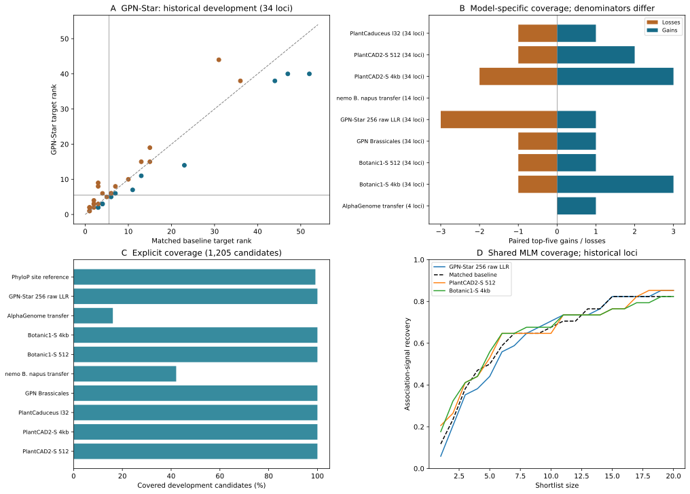
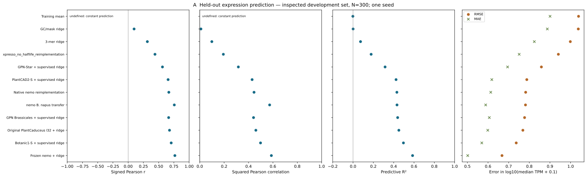
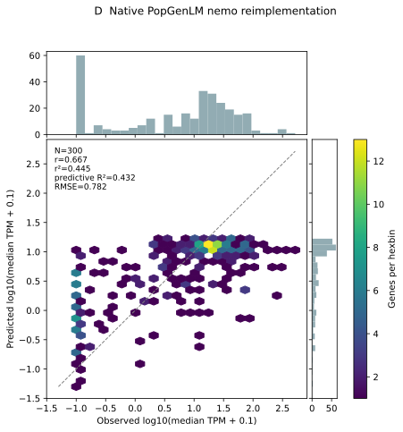
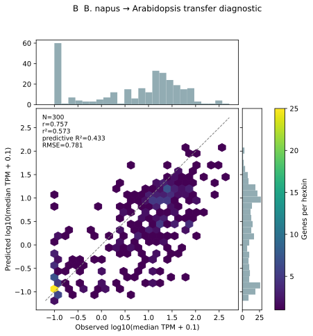
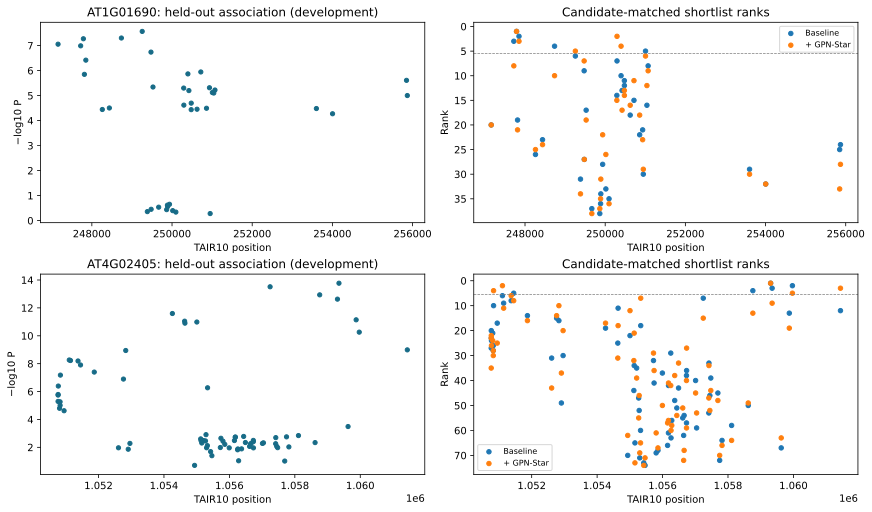
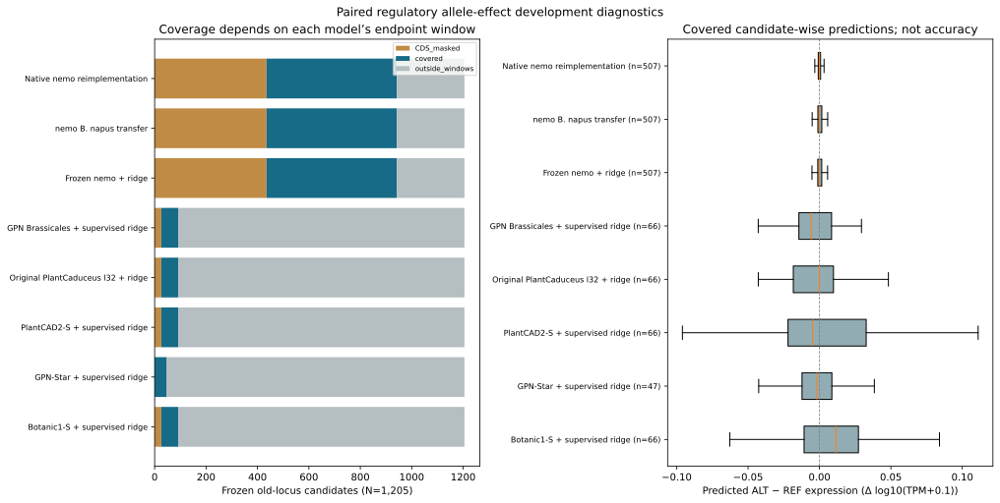
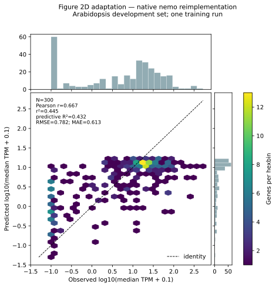
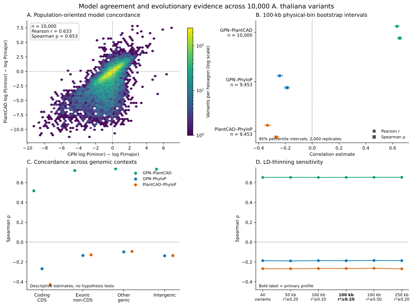

```{=html}
<style>
#v04-models table { display: block; max-width: 100%; overflow-x: auto; }
#v05-matrix table { min-width: 1040px; }
</style>
<section class="page-hero popgenlm-hero" aria-labelledby="popgenlm-title">
  <div class="eyebrow">Open-source scientific AI</div>
  <h1 id="popgenlm-title">PopGenLM Bench</h1>
  <p class="lead">I started PopGenLM Bench with 100 variants and a question I could test end to end: could I reproduce a genomic model’s scores and trace them back to the right alleles? Each release added a harder test. In v0.4, I ask whether adding a model score changes which linked variants I would follow up at an Arabidopsis expression locus.</p>
  <p class="hero-support">The benchmark brings my population-genetics experience into the software itself, through reference checks, explicit score definitions, matched comparisons, and reproducible reports. Follow the learning story in <a href="genomes-to-ai.html">Genomes to AI</a>.</p>
  <div class="tag-row">
    <span class="status-badge blue">v0.4.0 · Latest release</span>
    <span class="tag">v0.5 in development</span>
    <span class="tag">Seven evidence sources</span><span class="tag">Population genomics</span><span class="tag">Scientific AI engineering</span><span class="tag">Apache-2.0 code · source-specific data terms</span>
  </div>
  <div class="hero-actions">
    <a class="button-primary" href="https://github.com/tahirali-biomics/popgenlm-bench/tree/v0.4.0">View the benchmark</a>
    <a class="button-secondary" href="https://colab.research.google.com/github/tahirali-biomics/popgenlm-bench/blob/v0.4.0/notebooks/v0.4/popgenlm-v04-overview.ipynb">Reproduce in Colab</a>
    <a class="button-secondary" href="https://github.com/tahirali-biomics/popgenlm-bench/releases/tag/v0.4.0">Read the release</a>
  </div>
</section>
```

## v0.5 · Development update · Evaluation in progress

<p class="status-badge blue">Development staging · v0.4.0 remains the latest release</p>

v0.5 extends the benchmark from variant prioritization to two separate questions: how sequence models rank Arabidopsis variants, and whether sequence-derived representations can predict measured gene expression or paired regulatory allele effects. The engineering work adds reference/alignment contracts, model-specific provenance, separately supervised expression heads, family-aware gene splits, shared metrics and CPU-recomputed figures. Sequence likelihood and conservation remain variant/conservation evidence; they are not expression. A supervised head is an additional trained predictor and is labelled separately from the underlying sequence model.

**Every result on the inspected 300-gene set and the published v0.4 loci is development evidence.** The expression set has already influenced implementation. The additional 600 genes remain reserved and unscored; they will be opened only after the complete preprocessing, model/checkpoint, metric and comparison protocol is frozen. New independent variant loci are a separate unfinished endpoint: the expression reserve cannot replace them. Held-out association-signal recovery is not causal-nucleotide validation.

### Current model and task coverage {#v05-model-status}

The table retains the complete 22-row model/architecture/baseline scope. “Evaluated” means the named development analysis only; “validated” can refer to an adapter or paired-score check and does not mean an independent evaluation. Full evidence, software/inference/head/effect sub-statuses, exact paths, blockers and next actions are in the [development status and evidence registry](https://github.com/tahirali-biomics/popgenlm-bench/blob/c1cb283f734b8d60546923314ccef027e8b09eb3/docs/v0.5_development_status.md). The [focused Panel D notebook](https://colab.research.google.com/github/tahirali-biomics/popgenlm-bench/blob/8601f6eefa4bb111ecee5c64ac29c2269c2a49be/notebooks/v0.5/nemo_figure2_panel_d_public.ipynb) is a runnable cached-data reanalysis; it is not the overview notebook or a complete Figure 2 reproduction.

<p class="small">On a phone, swipe horizontally across the table to inspect all five task columns.</p>

<div id="v05-matrix" style="max-width:100%; overflow-x:auto">

| Model / architecture / baseline | Variant scoring | Absolute expression | Regulatory allele effects | Native / transfer evaluation | Figure / notebook / reproduction |
|---|---|---|---|---|---|
| PhyloP | evaluated | scientifically not applicable | scientifically not applicable | evaluated | implementing |
| GPN Brassicales | evaluated | evaluated | validated | evaluated | implementing |
| Original PlantCaduceus_l32 | evaluated | evaluated | validated | evaluated | implementing |
| PlantCAD2-S | evaluated | evaluated | validated | evaluated | implementing |
| Botanic1-S | evaluated | evaluated | validated | evaluated | implementing |
| GPN-MSA | validated | blocked | blocked | blocked | implementing |
| GPN-Star | validated | evaluated | validated | implementing | implementing |
| nemo native Arabidopsis reimplementation | validated | evaluated | validated | evaluated | implementing |
| nemo B. napus native evaluation and transfer | scientifically not applicable | evaluated | evaluated | blocked | implementing |
| AlphaGenome | evaluated | scientifically not applicable | evaluated | evaluated | implementing |
| nemo exact published native Arabidopsis | scientifically not applicable | blocked | blocked | blocked | blocked |
| nemo90 | scientifically not applicable | planned | planned | planned | planned |
| nemo80 | scientifically not applicable | planned | planned | planned | planned |
| Xpresso | scientifically not applicable | planned | planned | planned | planned |
| Xpresso without halflife | scientifically not applicable | evaluated | planned | planned | planned |
| PhytoExpr ensemble / CNN | scientifically not applicable | planned | planned | planned | planned |
| PhytoExpr transformer | scientifically not applicable | planned | planned | planned | planned |
| Basenji-5K | scientifically not applicable | planned | planned | planned | planned |
| Training mean | scientifically not applicable | evaluated | planned | evaluated | implementing |
| GC/mask ridge | scientifically not applicable | evaluated | planned | evaluated | implementing |
| 3-mer ridge | scientifically not applicable | evaluated | planned | evaluated | implementing |
| Separately supervised frozen nemo representation + ridge | scientifically not applicable | evaluated | planned | evaluated | implementing |

</div>

The original PlantCaduceus checkpoint remains **l32**, not a verified Small model. GPN-MSA’s locally pinned runtime is distinct from its upstream status: current upstream deprecates GPN-MSA in favor of GPN-Star and supports inference only; no compatible plant-trained checkpoint has been verified here. The Arabidopsis engineering POC is not published-model performance. GPN-Star has an Arabidopsis checkpoint/alignment and completed local inference, but its exact TAIR10 checkpoint-generation/context/calibration manifest remains unresolved. A 209-variant chromosome-1 audit gives FP16 signed calibrated-LLR MAE 0.000703 and maximum absolute residual 0.004519 against public scores; this subset-only residual audit does not settle the protocol. The independently supplied calibrated-magnitude field is not computed as the absolute signed score. Its 128-bp development comparison stays archived, and the 256-bp prioritization remains provisional. Neither GPN score is an expression measurement.

### Development figures: what is supported so far

```{=html}
<figure class="benchmark-figure popgenlm-release-figure">
  
  <figcaption><strong>Variant-prioritization development diagnostic · PopGenLM analysis.</strong> Uses the same 40 v0.4 development loci and 1,205 candidates from the 1001 Genomes v3.1 panel, reference-checked to TAIR10.1; site-level PlantRegMap PhyloP and model-specific variant scores are compared as separate evidence types. The GPN-Star ranking uses the archived fixed magnitude rule while context/calibration compatibility remains unresolved; it is not a final Star comparison. Association-signal recovery describes prioritization within these loci, not causal-nucleotide discovery. Botanic-derived plotted summaries are scholarly outputs with attribution and research-only notice; AlphaGenome-derived summaries remain subject to its output terms. Sources: <a href="#v04-references">model and dataset citations</a>. [<a href="assets/popgenlm/v0.5/variant_prioritization.svg">SVG</a> · <a href="assets/popgenlm/v0.5/variant_prioritization.png">PNG</a> · <a href="https://huggingface.co/living-models/Botanic1-S/tree/813d2d46ca40ab5cd91a6acaa8852d636224992e">pinned Botanic checkpoint/license</a> · <a href="https://github.com/tahirali-biomics/popgenlm-bench/blob/v0.4.0/data/benchmarks/v0.4/restricted_inputs.json">exact input schema/digest and acquisition route</a> · <a href="https://github.com/tahirali-biomics/popgenlm-bench/blob/v0.4.0/scripts/v0.4/score_botanic.py">variant scoring code</a> · <a href="https://github.com/tahirali-biomics/popgenlm-bench/blob/c1cb283f734b8d60546923314ccef027e8b09eb3/docs/v0.5_publication_terms.md">terms and provenance</a>]</figcaption>
</figure>

<figure class="benchmark-figure popgenlm-release-figure">
  
  <figcaption><strong>Held-out expression prediction — development set · PopGenLM analysis.</strong> Observed and predicted log<sub>10</sub>(median TPM + 0.1) for 300 Arabidopsis genes, using the current GSE80744-derived labels and the inspected development partition. Hexbin colour and marginal distributions use those same paired genes. The training-mean predictor has undefined Pearson correlation; it remains in error metrics. One training fit is shown, not a distribution of replicates. Botanic1-S is a separately supervised head; row-level head predictions and public head-fit code are not included yet. Required provider notice: “This work uses the Botanic™ model developed by Living Models, available under the Botanic™ Model License.” Research use only; no endorsement is implied. Sources: Rockenbach et al. (2026), <a href="https://doi.org/10.1093/plphys/kiag473">nemo paper</a>; Barozet et al. (2026), <a href="https://doi.org/10.64898/2026.09.04.749355">BOTANIC-1 v3</a>; <a href="https://www.ncbi.nlm.nih.gov/geo/query/acc.cgi?acc=GSE80744">GEO GSE80744</a>. [<a href="assets/popgenlm/v0.5/expression_performance.svg">SVG</a> · <a href="assets/popgenlm/v0.5/expression_performance.png">PNG</a> · <a href="https://github.com/tahirali-biomics/popgenlm-bench/blob/c1cb283f734b8d60546923314ccef027e8b09eb3/docs/v0.5_publication_terms.md">terms and provenance</a>]</figcaption>
</figure>

<figure class="benchmark-figure popgenlm-release-figure">
  
  <figcaption><strong>Arabidopsis native-model development comparison · PopGenLM analysis.</strong> Observed and predicted log<sub>10</sub>(median TPM + 0.1) for the same 300 GSE80744-derived development genes. The nemo predictor is a PopGenLM reimplementation with documented deviations from Rockenbach et al. (2026); frozen-representation ridge and sequence-model heads, including Botanic1-S, are separately supervised. Signed Pearson r, squared Pearson correlation, predictive R², RMSE, MAE and n are distinct. This is not the source paper’s ten-fold Figure 2 result. The figure is an aggregate development comparison; row-level Botanic head predictions and a public head-fit reproduction path are not in this bundle yet. Required notice for Botanic-derived values: “This work uses the Botanic™ model developed by Living Models, available under the Botanic™ Model License.” Research use only; no endorsement is implied. Sources: <a href="https://doi.org/10.1093/plphys/kiag473">Rockenbach et al. (2026)</a>; Barozet et al. (2026), <a href="https://doi.org/10.64898/2026.09.04.749355">BOTANIC-1 v3</a>; <a href="https://www.ncbi.nlm.nih.gov/geo/query/acc.cgi?acc=GSE80744">GSE80744</a>; sequence-model papers in <a href="#v04-references">the model citations</a>. [<a href="assets/popgenlm/v0.5/expression_native_arabidopsis.svg">SVG</a> · <a href="assets/popgenlm/v0.5/expression_native_arabidopsis.png">PNG</a> · <a href="https://github.com/tahirali-biomics/popgenlm-bench/blob/c1cb283f734b8d60546923314ccef027e8b09eb3/docs/v0.5_publication_terms.md">terms and provenance</a>]</figcaption>
</figure>

<figure class="benchmark-figure popgenlm-release-figure">
  
  <figcaption><strong>B. napus-to-Arabidopsis transfer diagnostic · PopGenLM analysis.</strong> Observed GSE80744-derived Arabidopsis log<sub>10</sub>(median TPM + 0.1) and available nemo transfer predictions on matched development genes. This is the available cross-species direction and is kept separate from native Arabidopsis prediction; homolog exposure and species/tissue calibration are unresolved. It does not establish a valid native B. napus evaluation or the opposite transfer. Sources: Rockenbach et al. (2026), <a href="https://doi.org/10.1093/plphys/kiag473">nemo paper</a>; <a href="https://www.ncbi.nlm.nih.gov/geo/query/acc.cgi?acc=GSE80744">GSE80744</a>. [<a href="assets/popgenlm/v0.5/expression_transfer_arabidopsis.svg">SVG</a> · <a href="assets/popgenlm/v0.5/expression_transfer_arabidopsis.png">PNG</a> · <a href="https://github.com/tahirali-biomics/popgenlm-bench/blob/c1cb283f734b8d60546923314ccef027e8b09eb3/docs/v0.5_publication_terms.md">terms and provenance</a>]</figcaption>
</figure>

<figure class="benchmark-figure popgenlm-release-figure">
  
  <figcaption><strong>Worked development loci · PopGenLM analysis.</strong> The 40 loci and 1,205 candidates are inherited from the 1001 Genomes v3.1/TAIR10.1 development panel. Model scores are transformations of each model’s own REF/ALT score semantics; these examples show ranking consequences, not independent causal evidence. Botanic attribution/research-only and AlphaGenome output-term notices apply to their plotted summaries. Sources: <a href="#v04-references">model and dataset citations</a>. [<a href="assets/popgenlm/v0.5/worked_loci.svg">SVG</a> · <a href="assets/popgenlm/v0.5/worked_loci.png">PNG</a> · <a href="https://github.com/tahirali-biomics/popgenlm-bench/blob/c1cb283f734b8d60546923314ccef027e8b09eb3/docs/v0.5_publication_terms.md">terms and provenance</a>]</figcaption>
</figure>

<figure class="benchmark-figure popgenlm-release-figure">
  
  <figcaption><strong>Paired regulatory allele-effect development analysis · PopGenLM analysis.</strong> Model outputs are paired ALT−REF changes in log<sub>10</sub>(TPM + 0.1) across the same 1,205 old-locus candidate IDs from the 1001 Genomes v3.1/TAIR10.1 panel; coverage differs by model, and this is not effect accuracy or causal-nucleotide validation. Model sources are cited in <a href="#v04-references">the release references</a>. Required notice for Botanic-derived values: “This work uses the Botanic™ model developed by Living Models, available under the Botanic™ Model License.” Research use only; no endorsement is implied. The raw Botanic variant-score table is withheld under Section 3(d); the pinned checkpoint, exact input schema/digest and variant scoring code are linked with the variant figure above. This expression-head/effect figure publishes aggregate scholarly results only; row-level Botanic head outputs and a public head-fit/effect reproduction code path remain unfinished, as tracked in the status registry. [<a href="assets/popgenlm/v0.5/paired_regulatory_effects.svg">SVG</a> · <a href="assets/popgenlm/v0.5/paired_regulatory_effects.png">PNG</a> · <a href="https://github.com/tahirali-biomics/popgenlm-bench/blob/c1cb283f734b8d60546923314ccef027e8b09eb3/docs/v0.5_publication_terms.md">terms and provenance</a>]</figcaption>
</figure>

<figure class="benchmark-figure popgenlm-release-figure">
  
  <figcaption><strong>Panel D · Arabidopsis observed versus predicted expression · PopGenLM adaptation.</strong> Rockenbach et al. (2026), Figure 2; GSE80744-derived labels; 300 paired development genes; one validation-selected PopGenLM nemo reimplementation fit. The target is log<sub>10</sub>(median TPM + 0.1), not raw TPM. Pearson r = 0.6672, squared Pearson correlation = 0.4452, predictive R² = 0.4315, RMSE = 0.7822, MAE = 0.6132. The source sample-selection mapping and exact training protocol are not reproduced; this is neither independent evaluation nor exact paper reproduction. For fresh source-data work, obtain matrix/metadata from <a href="https://www.ncbi.nlm.nih.gov/geo/query/acc.cgi?acc=GSE80744">GSE80744</a>; the 54-of-56 mapping remains unresolved. [<a href="assets/popgenlm/v0.5/nemo_figure2_panel_d.svg">SVG</a> · <a href="assets/popgenlm/v0.5/nemo_figure2_panel_d.png">PNG</a> · <a href="https://raw.githubusercontent.com/tahirali-biomics/popgenlm-bench/628e8d342608477c4f4967bb25d62fe976642459/data/benchmarks/v0.5-development/nemo_figure2_panel_d/panel_d_plotting_data.tsv">paired plotting data (TSV)</a> · <a href="https://github.com/tahirali-biomics/popgenlm-bench/blob/8601f6eefa4bb111ecee5c64ac29c2269c2a49be/notebooks/v0.5/nemo_figure2_panel_d_public.ipynb">plot/reanalysis code and notebook</a> · <a href="https://github.com/tahirali-biomics/popgenlm-bench/blob/c1cb283f734b8d60546923314ccef027e8b09eb3/docs/v0.5_publication_terms.md">terms and provenance</a>]</figcaption>
</figure>
```

In the current 300-gene diagnostic, the separately supervised frozen nemo-representation ridge has signed Pearson *r* = 0.766, predictive R² = 0.586, RMSE = 0.668 and MAE = 0.502; Botanic1-S has *r* = 0.706, r² = 0.4985, predictive R² = 0.4960, RMSE = 0.7365 and MAE = 0.5698. Native nemo reimplementation has *r* = 0.6672, r² = 0.4452, predictive R² = 0.4315, RMSE = 0.7822 and MAE = 0.6132. These are one-fit, development-only estimates after the inspected test set influenced design; they are not confirmatory performance differences. The B. napus transfer’s *r* = 0.757 but predictive R² = 0.433, demonstrating why correlation and predictive R² are reported separately. No significance stars or ten-run boxplots are inferred from one seed.

Botanic1-S head fitting completed in job **7726566** using cached representations and validation-only ridge selection; paired REF/ALT effect generation completed in job **7726567**. Those are implementation and development-validation results, not independent evaluation. The cached CPU container reanalysis passed as job **7726579**; it does not imply a public-input or independent researcher reproduction.

The compared labels are the same current expression target, log<sub>10</sub>(median TPM across the 54 retained current Atlas conditions + 0.1), with the saved accession/condition mapping. The current matrix has 57 columns; that column crosswalk does not itself prove recovery of the paper’s historical 54-of-56 sample selection. AT3G12510 has no observed value and is not imputed. Botanic1-S is a separately supervised expression head evaluated on this development split. The source paper reports squared Pearson correlation, not predictive R²; both are kept separate here, along with signed *r* and RMSE/MAE. Figure data excerpts, source-specific clauses, exact asset revisions, notices and reconstruction instructions are in the [v0.5 publication terms and provenance record](https://github.com/tahirali-biomics/popgenlm-bench/blob/c1cb283f734b8d60546923314ccef027e8b09eb3/docs/v0.5_publication_terms.md). The archived small plotting table is attributed and limited to the stated analysis; it is not a general-purpose expression dataset.

### Original Figure 2 plan and unfinished work

The reference is Rockenbach et al. (2026), [doi:10.1093/plphys/kiag473](https://doi.org/10.1093/plphys/kiag473). The exact source figure is not reproduced. Current PopGenLM plots are a **partial adaptation/reimplementation**. Planned Panel A retains the median- and maximum-expression targets and all original architecture comparators: nemo90, nemo80, Xpresso with and without half-life, PhytoExpr ensemble/CNN, PhytoExpr transformer, and Basenji-5K. Only available actual predictions are shown in the development plot; unfinished models are not replaced by other architectures. Panel B retains all four species directions—Arabidopsis native, B. napus native, Arabidopsis-to-B. napus, and B. napus-to-Arabidopsis—and the source ten joint species/family folds; current one-seed results do not reproduce them. Panel C (native B. napus observed versus predicted expression) and the missing transfer direction remain blocked by compatible labels, family folds and checkpoints. Panel D is the available Arabidopsis observed-versus-predicted development diagnostic. Source and reimplementation metrics remain distinct: squared Pearson correlation is not predictive R².

The completed six-epoch native nemo model is a **PopGenLM reimplementation**, not exact reproduction; it uses a different optimizer/schedule and current reconciled labels/transcripts/family components. The inspected test remains development and cannot be used to tune further models and then called confirmatory. The additional reserve must first be protected by a timestamped protocol freeze. Botanic’s separate ATAC-seq reproduction (Barozet et al., bioRxiv v3, requested Fig. 4b/4d) remains blocked by the missing held-out Arabidopsis accessibility labels/split, trained ATAC head or official predictions, matched ChromBPNet outputs and HY5 locus data. Zero-shot likelihood is not ATAC prediction.

GPN-Star and GPN-MSA follow the maintained [Song Lab GPN documentation](https://gpn.readthedocs.io/en/latest/) and [source repository](https://github.com/songlab-cal/gpn); the retained checkpoints are model-specific and the public GPN-MSA human checkpoint is not treated as an Arabidopsis model. GPN-Star’s current [TAIR10 model card](https://huggingface.co/songlab/gpn-star-tair10-b18-25m) is empty, so its exact checkpoint-generation/calibration details remain a documented limitation despite a local, species-matched checkpoint and alignment. See Ye et al. (2026), [GPN-Star](https://doi.org/10.1038/s41586-026-11005-5). The nemo source is [Rockenbach et al. (2026)](https://doi.org/10.1093/plphys/kiag473), Figure 2; Panel A’s original architecture comparators and median/maximum targets remain visible in the plan above.

The [focused Panel D Colab](https://colab.research.google.com/github/tahirali-biomics/popgenlm-bench/blob/8601f6eefa4bb111ecee5c64ac29c2269c2a49be/notebooks/v0.5/nemo_figure2_panel_d_public.ipynb) was tested from anonymous public raw-download URLs in a clean Python 3.11 environment; its outputs matched the pinned metrics. The Colab URL returned successfully for preview, but no hosted Google runtime execution is claimed. An overview notebook, remaining focused notebooks, public reproduction of all tasks, and actual independent researcher testing remain unfinished. Cached CPU container reanalysis passed as job 7726579. v0.1–v0.4 notebooks and their release pins remain unchanged.

## v0.4.0 — Regulatory Variant Prioritization Pilot {#v04}

**v0.4.0 · Latest release**

v0.4 adds frozen discovery/holdout inputs, restartable model scoring, candidate-matched comparisons, and a shared CPU reproduction path. I can now inspect how a model changes the shortlist at an expression locus, including the variants it displaces. The endpoint is **held-out association-signal recovery** in the same study—not independent causal-nucleotide validation. **Causal-SNP recovery remains unestimable: zero eligible loci.**

```{=html}
<figure class="benchmark-figure popgenlm-release-figure">
  
  <figcaption><strong>Paired ranks before the headline percentage.</strong> PlantCAD2-S at 512 bp recovers 18/34 held-out signals versus 17/34 for the annotation baseline, with two gains and one loss. Comparisons use identical candidates and loci. AlphaGenome’s four-locus denominator stays separate. <strong>PopGenLM adaptation from cached inference</strong>, not a source-data redraw or inference rerun. Models and original methods are cited <a href="#v04-references">below</a>. <a href="https://raw.githubusercontent.com/tahirali-biomics/popgenlm-bench/v0.4.0/figures/v0.4/benchmark.svg">Open SVG</a> · <a href="https://raw.githubusercontent.com/tahirali-biomics/popgenlm-bench/v0.4.0/figures/v0.4/benchmark.png">Download PNG</a></figcaption>
</figure>
```

| Magnitude rule | Held-out signals: model vs matched baseline | Top-five gains / losses |
|---|---|---|
| PlantCAD2-S · 512 bp | **18/34 versus 17/34** | 2 / 1 |
| PlantCAD2-S · 4 kb | 18/34 versus 17/34 | 3 / 2 |
| Botanic1-S · 512 bp | 17/34 versus 17/34 | 1 / 1 |
| Botanic1-S · 4 kb | **19/34 versus 17/34** | **3 / 1** |
| GPN Brassicales · 512 bp | 17/34 versus 17/34 | 1 / 1 |
| Original PlantCAD · l32 · 512 bp | 17/34 versus 17/34 | 1 / 1 |
| nemo · *B. napus* transfer | **8/14 versus 8/14** | 0 / 0 |
| AlphaGenome · mammalian-to-plant transfer | **2/4 versus 1/4** | 1 / 0 |

Signed PlantCAD2-S (22/34 versus 17/34) and signed Botanic1-S (21/34 versus 17/34) were explored on the original loci and remain **exploratory**. No fitted weights or confirmatory causal claim is made. The chromosome-block uncertainty is descriptive, with only five blocks on the full panel and two on the AlphaGenome subset. [Exact metrics and protocol](https://github.com/tahirali-biomics/popgenlm-bench/blob/v0.4.0/docs/v0.4_release.md).

### A shortlist gain—and the SNP that leaves {#v04-worked-locus}

```{=html}
<figure class="benchmark-figure popgenlm-release-figure">
  
  <figcaption><strong>AT1G01690.</strong> PlantCAD2-S moves the held-out association target <code>1:249256:T:C</code> from rank 6 to 4; <code>1:247721:C:T</code> leaves the shortlist, rank 3 to 6. A gene model, association evidence, LD, site conservation and model outputs share a TAIR10.1 axis. <strong>PopGenLM adaptation</strong> from frozen <a href="#v04-references">1001 Genomes, TAIR10.1, GSE80744 and model evidence</a>; the association target is a proxy, not causal truth. <a href="https://raw.githubusercontent.com/tahirali-biomics/popgenlm-bench/v0.4.0/figures/v0.4/AT1G01690_shortlist_changes.tsv">Exact membership</a> · <a href="https://raw.githubusercontent.com/tahirali-biomics/popgenlm-bench/v0.4.0/figures/v0.4/locus_AT1G01690.svg">Open SVG</a> · <a href="https://raw.githubusercontent.com/tahirali-biomics/popgenlm-bench/v0.4.0/figures/v0.4/locus_AT1G01690.png">Download PNG</a>.</figcaption>
</figure>
```

The package also shows the loss at [AT4G02405](https://raw.githubusercontent.com/tahirali-biomics/popgenlm-bench/v0.4.0/figures/v0.4/locus_AT4G02405.svg): its target moves from rank 3 to 11. Showing both outcomes changed how I report the benchmark: a net gain of one signal does not mean every locus improves.

### Seven models and evidence sources {#v04-models}

Each figure reflects the method’s output. Exact checkpoint revisions, score units, strand handling, coverage and evaluation endpoints are in the [release evidence table](https://github.com/tahirali-biomics/popgenlm-bench/blob/v0.4.0/docs/v0.4_release.md#model-identity-and-evidence). Original raw outputs remain distinct from oriented/harmonized scores. **“Original PlantCAD-S” is a historical label: the verified checkpoint actually used is `kuleshov-group/PlantCaduceus_l32`, not a verified Small checkpoint.**

| Model / evidence | Role and candidate coverage | Figure · focused Colab |
|---|---|---|
| **PhyloP** | Site-level conservation reference; 1,195/1,205 covered, ten missing; never allele-oriented | [Figure](https://raw.githubusercontent.com/tahirali-biomics/popgenlm-bench/v0.4.0/figures/v0.4/phylop.svg) · [Colab](https://colab.research.google.com/github/tahirali-biomics/popgenlm-bench/blob/v0.4.0/notebooks/v0.4/popgenlm-v04-phylop.ipynb) |
| **GPN Brassicales** | 512-bp sequence likelihood; 1,205/1,205; v0.3 population evidence retained | [Figure](https://raw.githubusercontent.com/tahirali-biomics/popgenlm-bench/v0.4.0/figures/v0.4/gpn.svg) · [Colab](https://colab.research.google.com/github/tahirali-biomics/popgenlm-bench/blob/v0.4.0/notebooks/v0.4/popgenlm-v04-gpn.ipynb) |
| **Original PlantCAD-S / l32** | 512-bp sequence likelihood; 1,205/1,205; v0.3 evidence retained | [Figure](https://raw.githubusercontent.com/tahirali-biomics/popgenlm-bench/v0.4.0/figures/v0.4/plantcad.svg) · [Colab](https://colab.research.google.com/github/tahirali-biomics/popgenlm-bench/blob/v0.4.0/notebooks/v0.4/popgenlm-v04-plantcad.ipynb) |
| **PlantCAD2-S** | Context/likelihood comparison at 512 bp and 4 kb; 1,205/1,205 each | [Figure](https://raw.githubusercontent.com/tahirali-biomics/popgenlm-bench/v0.4.0/figures/v0.4/plantcad2.svg) · [Colab](https://colab.research.google.com/github/tahirali-biomics/popgenlm-bench/blob/v0.4.0/notebooks/v0.4/popgenlm-v04-plantcad2.ipynb) |
| **Botanic1-S** | Completed 512-bp/4-kb zero-shot comparison; 1,205/1,205 each; separate ATAC reproduction limited below | [Figure](https://raw.githubusercontent.com/tahirali-biomics/popgenlm-bench/v0.4.0/figures/v0.4/botanic.svg) · [Colab](https://colab.research.google.com/github/tahirali-biomics/popgenlm-bench/blob/v0.4.0/notebooks/v0.4/popgenlm-v04-botanic.ipynb) |
| **nemo** | Predicted expression delta; *B. napus* transfer, 507/1,205; native *A. thaliana* resources missing | [Figure](https://raw.githubusercontent.com/tahirali-biomics/popgenlm-bench/v0.4.0/figures/v0.4/nemo.svg) · [Colab](https://colab.research.google.com/github/tahirali-biomics/popgenlm-bench/blob/v0.4.0/notebooks/v0.4/popgenlm-v04-nemo.ipynb) |
| **AlphaGenome** | Mammalian-to-plant RNA-seq transfer; 194/1,205, five predefined loci, four evaluable | [Figure](https://raw.githubusercontent.com/tahirali-biomics/popgenlm-bench/v0.4.0/figures/v0.4/alphagenome.svg) · [Colab](https://colab.research.google.com/github/tahirali-biomics/popgenlm-bench/blob/v0.4.0/notebooks/v0.4/popgenlm-v04-alphagenome.ipynb) |

**Figure provenance and limits.** All are PopGenLM adaptations from cached evidence. AlphaGenome adapts **Avsec et al. Fig. 4b and 6b**: paired REF/ALT predictions and differences, with the focal SNP and gene model. Its display is human plus-strand neuronal stem-cell polyA RNA-seq track 0, API v1 `ALL_FOLDS`, SDK 0.11.0; ranking retains all 667 tracks. [Observed Arabidopsis expression by genotype](https://raw.githubusercontent.com/tahirali-biomics/popgenlm-bench/v0.4.0/figures/v0.4/observed_arabidopsis.svg) is a separate GSE80744 panel, not measured RNA-seq coverage or mammalian-track calibration. The four eligible AlphaGenome target-rank changes are AT3G23110:6→4, AT3G53880:47→41, AT4G14840:15→13, AT4G33940:1→2. AT2G22240 is illustrative and ineligible.

The nemo figure adapts the expression-contrast idea of **Rockenbach et al. Fig. 3a**, showing predicted ALT−REF expression changes by promoter/terminator position and the coverage-matched 8/14 versus 8/14 result. It does not reproduce native Arabidopsis accuracy: family-safe native weights/folds, reconciled expression inputs and scalers remain missing. *B. napus* transfer and native *A. thaliana* nemo are not interchangeable.

In **Barozet et al., bioRxiv v3**, **Fig. 4b** compares predicted and observed ATAC-seq signal on held-out peaks, and **Fig. 4d** shows the representative *Arabidopsis* HY5 locus. PopGenLM’s separate **Arabidopsis ATAC-seq reproduction remains blocked**: verified accessibility measurements, held-out chromosome 4 peaks/labels/split, the fine-tuned ATAC head or official predictions, and matched ChromBPNet outputs are unavailable. The completed zero-shot context comparison is not a substitute for accessibility prediction.

### Reproduce the public package {#v04-reproduction}

[**Overview Colab**](https://colab.research.google.com/github/tahirali-biomics/popgenlm-bench/blob/v0.4.0/notebooks/v0.4/popgenlm-v04-overview.ipynb) · [**Public CPU input bundle**](https://github.com/tahirali-biomics/popgenlm-bench/releases/download/v0.4.0/popgenlm-v04-public-inputs.zip) · [**Executed notebooks**](https://github.com/tahirali-biomics/popgenlm-bench/releases/download/v0.4.0/executed-notebooks.zip) · [**Download checksums**](https://github.com/tahirali-biomics/popgenlm-bench/releases/download/v0.4.0/SHA256SUMS.txt).

Eight notebooks passed in a clean local CPU environment, each with a fresh kernel and archive extraction. They verify pinned checksums, reconstruct the available score-based ranks, and check paired outcomes. **Local execution is distinct from hosted testing:** anonymous Colab previews are checked; no notebook is claimed to have run in a signed-in Google-hosted runtime.

Code is Apache-2.0; model outputs retain their own terms. Raw Botanic scores are excluded: its public notebook verifies published rank/count arithmetic and displays the frozen LLR/context figure, rather than reconstructing omitted raw scores. AlphaGenome reproduces cached-score ranks and the illustrative track, not every full 667-track API aggregation. [Exact reproduction scope, separately obtained inputs and provider notices](https://github.com/tahirali-biomics/popgenlm-bench/blob/v0.4.0/docs/v0.4_data_terms.md).

This work uses the Botanic™ model developed by Living Models, available under the Botanic™ Model License; research publication, as-is, with the modifications stated in the release. AlphaGenome outputs and derivatives are subject to its [Output Terms of Use](https://deepmind.google.com/science/alphagenome/output-terms). Neither provider’s outputs are relicensed as Apache data.

### What the engineering changed {#v04-engineering}

I froze the accession split and candidate set before scoring, retained raw allele/strand definitions, and required each model and baseline to rank the same SNPs. That decision prevents coverage differences from becoming apparent model gains. Restartable shards, reference checks, checksum-pinned inputs and one shared evaluation implementation make the result inspectable beyond RAMSES. The gain and loss loci make the biological consequence visible. The result justifies transparent follow-up shortlists and independent tests; it does not identify causal nucleotides.

Read the [v0.4 Genomes to AI release note](https://github.com/tahirali-biomics/popgenlm-bench/blob/v0.4.0/docs/v0.4_genomes_to_ai.md) alongside [my journal](genomes-to-ai.html).

### Citations and data sources {#v04-references}

- **GPN:** Benegas, Batra and Song (2023), *DNA language models are powerful predictors of genome-wide variant effects*. [10.1073/pnas.2311219120](https://pmc.ncbi.nlm.nih.gov/articles/PMC10622914/).
- **PlantCaduceus:** Zhai et al. (2025), *Cross-species modeling of plant genomes at single-nucleotide resolution using a pretrained DNA language model*. [10.1073/pnas.2421738122](https://pmc.ncbi.nlm.nih.gov/articles/PMC12184517/).
- **PlantCAD2:** Zhai et al. (2026), *PlantCAD2: A DNA foundation model for interpreting genomes across flowering plants*. [10.1016/j.xgen.2026.101329](https://pmc.ncbi.nlm.nih.gov/articles/PMC13576720/).
- **Botanic1:** Barozet et al. (2026), *BOTANIC-1*, bioRxiv **v3**. [10.64898/2026.09.04.749355](https://www.biorxiv.org/content/10.64898/2026.09.04.749355v3.full); separate requested ATAC panels 4b/4d, limits above.
- **nemo:** Rockenbach et al. (2026), *A deep learning model captures position-specific effects of plant regulatory sequences and suggests genes under complex regulation*. [10.1093/plphys/kiag473](https://pubmed.ncbi.nlm.nih.gov/42413033/), Fig. 3a.
- **AlphaGenome:** Avsec et al. (2026), *Advancing regulatory variant effect prediction with AlphaGenome*. [10.1038/s41586-025-10014-0](https://pmc.ncbi.nlm.nih.gov/articles/PMC12851941/), Fig. 4b/6b.
- **PhyloP method:** Pollard et al. (2010), *Detection of nonneutral substitution rates on mammalian phylogenies*. [10.1101/gr.097857.109](https://pubmed.ncbi.nlm.nih.gov/19858363/). **Actual plant track:** PlantRegMap `Ath_PhyloP.bedGraph.gz`; Tian et al. (2020), [10.1093/nar/gkz1020](https://pubmed.ncbi.nlm.nih.gov/31701126/). [Track URL and exact hash](https://github.com/tahirali-biomics/popgenlm-bench/blob/v0.4.0/data/benchmarks/v0.4/acquisition.json).
- **Population/input validation:** 1001 Genomes Consortium (2016), [10.1016/j.cell.2016.05.063](https://pubmed.ncbi.nlm.nih.gov/27293186/); v3.1 genotype callset joined by accession and REF-checked against [NCBI TAIR10.1, GCF_000001735.4](https://www.ncbi.nlm.nih.gov/datasets/genome/GCF_000001735.4/).
- **Expression join:** [GSE80744](https://www.ncbi.nlm.nih.gov/geo/query/acc.cgi?acc=GSE80744), Kawakatsu et al. (2016), [10.1016/j.cell.2016.06.044](https://pubmed.ncbi.nlm.nih.gov/27419873/), processed normalized gene expression.
- **cis-eQTL/regulatory source and reporter audit:** Voichek et al. (2024), *Widespread position-dependent transcriptional regulatory sequences in plants*, [10.1038/s41588-024-01907-3](https://pubmed.ncbi.nlm.nih.gov/39266765/), [exact code deposit 13170729](https://zenodo.org/records/13170729). PopGenLM recomputes accession-split LOCO mapping; it does not claim an exact rerun of that study’s batch analysis.

## Why PopGenLM Bench is needed

<p class="lead">Producing a score is an inference step. Establishing what that score means is an evaluation problem.</p>

DNA language models learn statistical regularities from sequence context and can assign scores to large numbers of candidate variants. But a technically valid score is not automatically biological evidence. Before a score is interpreted, its coordinate system, alleles, reference sequence, model revision, orientation, provenance, statistical behaviour, and relationship to independent biological observations need to be checked.

Population and evolutionary genomics provide evidence against which model scores can be evaluated. PopGenLM Bench is designed as the reproducible layer between **model output** and **biological claim**: validate the inputs, preserve inference provenance, orient scores explicitly, quantify associations and uncertainty, and state what the result does — and does not — support.

```{=html}
<div class="validation-stack" aria-label="Validation layers">
  <article><span>01</span><div><h3>Input integrity</h3><p>Genome build, chromosome mapping, coordinates, REF/ALT alleles, duplicates, missingness, and sequence context.</p></div></article>
  <article><span>02</span><div><h3>Inference provenance</h3><p>Model revision, upstream code, packages, parameters, device, inputs, outputs, runtime, and hashes.</p></div></article>
  <article><span>03</span><div><h3>Population orientation</h3><p>Separate raw REF-to-ALT model scores from population minor-vs-major scores so the biological comparison is explicit.</p></div></article>
  <article><span>04</span><div><h3>Biological concordance</h3><p>Evaluate model concordance with allele frequency, conservation, and genomic context, while testing LD sensitivity and summarizing population structure.</p></div></article>
</div>
```

## v0.3.0 — Evolutionary evidence

**v0.3.0 · Released**

v0.3.0 added the ability to integrate frozen model outputs with genomic annotations and LD-aware descriptive checks. It integrates population-oriented GPN and PlantCAD scores with evolutionary and genomic evidence for **10,000 real *Arabidopsis thaliana* population variants selected using a deterministic procedure.** The release is organized around a frozen **10,000 × 39 annotated master table**, with exclusive genomic-context annotations, signed site-oriented PhyloP conservation, fixed physical-bin and LD-sensitivity analyses, genotype-quality summaries, and UMAP population-structure summaries.

The v0.3 release assets are frozen and hash-verified. Its primary population score is `log P(minor allele) − log P(major allele)`. Raw model scores retain `log P(ALT) − log P(REF)`. PhyloP is **site-oriented, not allele-oriented**, so its sign is not treated as an allele preference.

### Validated descriptive results

- GPN–PlantCAD: Spearman ρ = **0.6525**, Pearson r = **0.6331**, *n* = **10,000**.
- GPN–PhyloP: Spearman ρ = **−0.1876**, *n* = **9,453**.
- GPN–PlantCAD remains approximately **0.6523–0.6534** across released LD profiles.
- Context-stratified GPN–PlantCAD Spearman correlations range from **0.5171** in coding CDS to **0.7349** in intergenic variants.

The sample-quality summaries contain **1,135 samples** in the sample-quality table, **1,093 samples** in the primary call-rate set, **996 samples** in the strict set, and geographic metadata for **1,131 samples**.

These are descriptive associations. They do not show that either model directly measures fitness, selection, causality, or pathogenicity. v0.3.0 claims no hypothesis-test *p*-values.

```{=html}
<figure class="benchmark-figure popgenlm-release-figure">
  
  <figcaption><strong>v0.3.0 model evidence.</strong> A: GPN–PlantCAD population-oriented concordance. B: physical-bin bootstrap intervals. C: concordance across genomic contexts. D: LD-thinning sensitivity. <a href="assets/popgenlm/v0.3/model_evidence.svg">Open SVG</a> · <a href="assets/popgenlm/v0.3/model_evidence.png">Download PNG</a></figcaption>
</figure>
<figure class="benchmark-figure popgenlm-release-figure">
  
  <figcaption><strong>v0.3.0 genotype structure and geography.</strong> A: full UMAP coloured by longitude. B: full UMAP coloured by genotype call rate. C: connected main cloud enlarged and coloured by longitude. D: connected main cloud enlarged and coloured by latitude. <a href="assets/popgenlm/v0.3/genotype_umap_geography.svg">Open SVG</a> · <a href="assets/popgenlm/v0.3/genotype_umap_geography.png">Download PNG</a></figcaption>
</figure>
```

```{=html}
<div class="link-row">
  <a class="button-primary" href="https://colab.research.google.com/github/tahirali-biomics/popgenlm-bench/blob/v0.3.0/notebooks/popgenlm-bench-v0.3.ipynb">Open v0.3.0 in Colab</a>
  <a class="button-secondary" href="https://github.com/tahirali-biomics/popgenlm-bench/blob/v0.3.0/docs/v0.3_release.md">Read full v0.3.0 documentation</a>
  <a class="button-secondary" href="https://github.com/tahirali-biomics/popgenlm-bench/releases/tag/v0.3.0">Release notes</a>
</div>
```

## v0.3.0 Colab — inspect the frozen release

The public notebook loads, verifies, summarizes, and displays the frozen v0.3.0 assets. It does not rerun PlantCAD/GPN inference, VCF processing, UMAP fitting, or bootstrap production analysis.

```{=html}
<div class="colab-panel"><div><div class="card-kicker">v0.3.0 · Released</div><h3>Frozen assets with transparent validation</h3><p>The notebook is pinned to v0.3.0 and checks the released files before loading the descriptive summaries and displaying the frozen figures.</p></div><a class="button-colab" href="https://colab.research.google.com/github/tahirali-biomics/popgenlm-bench/blob/v0.3.0/notebooks/popgenlm-bench-v0.3.ipynb">Open v0.3.0 in Google Colab</a></div>
```

<span id="v0.2.0-population-aware-gpn-benchmark"></span>

## v0.2.0 — Population-aware benchmark

**v0.2.0 · Released**

```{=html}
<section class="benchmark-summary" aria-label="PopGenLM Bench v0.2.0 summary">
  <div class="benchmark-copy">
    <div class="card-kicker">v0.2.0 · Released · Population-aware benchmark</div>
    <h3>10,000 real <em>Arabidopsis thaliana</em> variants</h3>
    <p>v0.2.0 added deterministic population sampling, exact reference validation and explicit minor-versus-major score orientation. It uses deterministically selected biallelic SNPs from the 1001 Genomes Project, validates every REF allele against TAIR10.1, combines population summaries with reproducible GPN Brassicales scores, and evaluates the relationship between minor-allele frequency and model score.</p>
  </div>
  <div class="stats-grid benchmark-stats">
    <div class="stat-card"><span class="stat-value">10,000</span><span class="stat-label">population variants</span></div>
    <div class="stat-card"><span class="stat-value">7,209</span><span class="stat-label">rare variants, MAF &lt; 0.01</span></div>
    <div class="stat-card"><span class="stat-value">ρ = 0.061</span><span class="stat-label">MAF × GPN association</span></div>
    <div class="stat-card"><span class="stat-value">−0.132</span><span class="stat-label">rare-vs-common rank-biserial effect</span></div>
  </div>
  <figure class="benchmark-figure">
    
    <figcaption>PopGenLM Bench v0.2.0. Rare variants dominate the benchmark, the MAF–score association is weak, frequency classes overlap substantially, and 246 ALT-major variants require a sign reversal when the raw REF-to-ALT GPN score is oriented as minor versus major.</figcaption>
  </figure>
</section>
```

The primary population-oriented score is `log P(minor) − log P(major)`. Negative values mean that GPN assigns lower sequence likelihood to the population minor allele than to the major allele.

For variants in which ALT is the minor allele, the raw score `log P(ALT) − log P(REF)` already has the required orientation. For the **246 ALT-major variants**, the sign is reversed. This transformation makes the population comparison explicit; it does not create the observed genome-wide association.

### Main result

Across the 10,000-variant benchmark:

- **Spearman ρ = 0.0611** between MAF and the GPN minor-vs-major score;
- chromosome-stratified **Monte Carlo p = 1 / 10,001**;
- rare variants have median score **−0.3485**;
- common variants have median score **−0.1562**;
- rare versus common rank-biserial effect = **−0.1322**;
- bootstrap 95% CI = **[−0.1665, −0.0973]**.

The result is therefore **weak but reproducible concordance**, not strong predictive separation. The distributions overlap extensively.

<div class="interpretation-note"><strong>Interpretation boundary:</strong> this result is not evidence that GPN directly predicts natural selection. Population demography, structure, linkage disequilibrium, ascertainment, allele age, and other evolutionary processes may contribute. The chromosome-stratified permutation preserves chromosome membership but does not explicitly model local LD.</div>

### Robustness

The positive association remains under stricter data filters:

| Analysis | n | Spearman ρ |
|---|---:|---:|
| All variants | 10,000 | 0.0611 |
| Call rate ≥ 0.95 | 6,761 | 0.0581 |
| MAC ≥ 5 | 5,057 | 0.0876 |
| Call rate ≥ 0.95 and MAC ≥ 5 | 3,279 | 0.1002 |

The association is also positive separately on chromosomes 1–5 and remains positive after excluding each chromosome in turn. This supports the conclusion that the genome-wide direction is not being driven by a single chromosome.

```{=html}
<div class="link-row">
  <a class="button-primary" href="https://colab.research.google.com/github/tahirali-biomics/popgenlm-bench/blob/v0.2.0/notebooks/popgenlm-bench-v0.2.ipynb">Open v0.2.0 in Colab</a>
  <a class="button-secondary" href="https://github.com/tahirali-biomics/popgenlm-bench/blob/v0.2.0/reports/v0.2/README.md">Read full v0.2.0 report</a>
  <a class="button-secondary" href="https://github.com/tahirali-biomics/popgenlm-bench/releases/tag/v0.2.0">Release notes</a>
  <a class="button-secondary" href="https://github.com/tahirali-biomics/popgenlm-bench/tree/v0.2.0">Browse v0.2.0 source</a>
</div>
```

## v0.2.0 Colab — reproduce the public result

The release notebook is intentionally lightweight. It starts from the frozen population + GPN benchmark rather than rerunning the expensive 10,000-variant GPN inference.

It:

1. downloads the immutable v0.2.0 benchmark artifacts;
2. verifies their SHA256 checksums;
3. validates the 10,000 unique biallelic variant keys and score schema;
4. checks the minor-vs-major orientation, including the 246 sign flips;
5. recomputes the allele-frequency spectrum and the main Spearman association;
6. compares rare, low-frequency, and common variants;
7. visualizes the score-orientation transformation; and
8. loads the frozen sensitivity and chromosome-robustness results.

```{=html}
<div class="colab-panel">
  <div>
    <div class="card-kicker">v0.2.0 · Released</div>
    <h3>Population-aware validation without rerunning model inference</h3>
    <p>The notebook is pinned to the v0.2.0 release and can be run directly in Google Colab. It verifies the released artifacts before reproducing the main analysis.</p>
  </div>
  <a class="button-colab" href="https://colab.research.google.com/github/tahirali-biomics/popgenlm-bench/blob/v0.2.0/notebooks/popgenlm-bench-v0.2.ipynb">Open v0.2.0 in Google Colab</a>
</div>
```

## v0.1.0 — Reproducible analysis foundation

**v0.1.0 · Released**

v0.1.0 established the engineering foundation: verify a score table, preserve allele/metadata contracts, and reproduce a report end to end. It remains an active, frozen PopGenLM Bench analysis fixture. It contains **100 deterministic SNVs with verified GPN scores**, together with the score table, metadata, schema checks, descriptive statistics, bootstrap uncertainty, figures, and a CPU-compatible Colab notebook.

The important distinction is that v0.1.0 is an **engineering and analysis fixture**, not a sampled population benchmark. It established a reproducible analysis path before population-aware evaluation was added in v0.2.0.

```{=html}
<section class="benchmark-summary" aria-label="PopGenLM Bench v0.1.0 summary">
  <div class="benchmark-copy">
    <div class="card-kicker">v0.1.0 · Released · Reproducible analysis foundation</div>
    <h3>100 deterministic variants with verified GPN scores</h3>
    <p>v0.1.0 validates score-table structure, metadata, descriptive analysis, bootstrap uncertainty, and figure generation. It does not by itself support population-genetic or evolutionary claims.</p>
  </div>
  <div class="stats-grid benchmark-stats">
    <div class="stat-card"><span class="stat-value">100</span><span class="stat-label">deterministic SNVs</span></div>
    <div class="stat-card"><span class="stat-value">100</span><span class="stat-label">complete GPN scores</span></div>
    <div class="stat-card"><span class="stat-value">−1.031</span><span class="stat-label">median score</span></div>
    <div class="stat-card"><span class="stat-value">77%</span><span class="stat-label">scores below zero</span></div>
  </div>
  <figure class="benchmark-figure">
    
    <figcaption>v0.1.0 verified analysis fixture. These are model-score summaries for a deterministic engineering dataset, not population-frequency evidence.</figcaption>
  </figure>
</section>
```

<div class="interpretation-note"><strong>v0.1.0 interpretation boundary:</strong> the deterministic 100-variant fixture is not a sampled population. It verifies analysis, schema, provenance, and reporting; it is not evidence for selection, functional constraint, or a population-level effect.</div>

```{=html}
<div class="link-row">
  <a class="button-primary" href="https://colab.research.google.com/github/tahirali-biomics/popgenlm-bench/blob/v0.1.0/notebooks/popgenlm-bench-demo.ipynb">Open v0.1.0 in Colab</a>
  <a class="button-secondary" href="https://github.com/tahirali-biomics/popgenlm-bench/tree/v0.1.0">Browse v0.1.0 source</a>
  <a class="button-secondary" href="assets/popgenlm/gpn-scores-100.tsv">Download v0.1 score table</a>
  <a class="button-secondary" href="assets/popgenlm/summary.json">View v0.1 summary</a>
  <a class="button-secondary" href="assets/popgenlm/run-metadata.json">Inspect v0.1 metadata</a>
</div>
```

## From model score to biological evidence

```{=html}
<div class="evidence-pipeline" role="img" aria-label="PopGenLM Bench evidence pipeline">
  <div class="evidence-node"><span>Input</span><strong>Variants + reference</strong><small>Coordinates, alleles, sequence</small></div>
  <div class="evidence-arrow" aria-hidden="true">→</div>
  <div class="evidence-node"><span>Model</span><strong>Sequence score</strong><small>Explicit score semantics</small></div>
  <div class="evidence-arrow" aria-hidden="true">→</div>
  <div class="evidence-node"><span>Population</span><strong>MAF + orientation</strong><small>Minor versus major allele</small></div>
  <div class="evidence-arrow" aria-hidden="true">→</div>
  <div class="evidence-node accent"><span>Evidence</span><strong>Effect + uncertainty</strong><small>Concordance and limits</small></div>
</div>
```

The central design principle is separation of concerns. Model scoring, reference validation, population orientation, statistical evaluation, and biological interpretation remain distinct steps. This makes failure modes inspectable and helps prevent a model score from being promoted directly into a biological claim.

## Version history and roadmap

The learning path is chronological: v0.1 verified a 100-variant fixture end to end; v0.2 made the reference and population allele comparison explicit; v0.3 added evolutionary evidence and LD checks; v0.4 tests which linked SNPs a researcher would follow up. v0.5 is extending that evaluation to gene-expression prediction and paired regulatory effects while preserving model-specific score meaning and a complete reproduction record. v0.4 remains the latest release; v0.5 is still development, not a completed benchmark.

### Released versions

```{=html}
<div class="roadmap">
  <div class="roadmap-item"><h4><a href="#v04">v0.4.0 · Latest release</a></h4><p><strong>Regulatory Variant Prioritization Pilot.</strong> Candidate-matched per-locus rankings, seven evidence sources, and CPU reproduction from the public release bundle.</p></div>
  <div class="roadmap-item"><h4><a href="#v0.3.0-evolutionary-evidence">v0.3.0 · Released</a></h4><p><strong>Evolutionary evidence.</strong> Multi-model comparison with PhyloP, genomic context, and LD sensitivity.</p></div>
  <div class="roadmap-item"><h4><a href="#v0.2.0-population-aware-benchmark">v0.2.0 · Released</a></h4><p><strong>Population-aware benchmark.</strong> 10,000 <em>Arabidopsis thaliana</em> SNPs from 1001 Genomes, TAIR10.1 reference checks, and explicit minor-versus-major score orientation.</p></div>
  <div class="roadmap-item"><h4><a href="#v0.1.0-reproducible-analysis-foundation">v0.1.0 · Released</a></h4><p><strong>Reproducible analysis foundation.</strong> A verified 100-variant GPN fixture with validation and reproducible reporting.</p></div>
</div>
```

### Planned releases

```{=html}
<div class="roadmap">
  <div class="roadmap-item"><h4>v0.5 · Genomic and expression evaluation · In development</h4><p>The scope retains all planned genomic models, original nemo Figure 2 architectures and native/transfer directions, separately supervised expression heads, and the distinct Botanic ATAC reproduction. The inspected 300-gene set and existing 40 loci are development data; 600 genes remain reserved until the protocol is frozen. New independent variant loci, missing checkpoints/labels, complete focused notebooks, public immutable pins, container reproduction and external researcher testing remain open. This page is staging only; v0.4 remains the latest release.</p></div>
  <div class="roadmap-item"><h4>v1.0 · Stable, citable release · Planned</h4><p>Incorporate beta feedback, freeze the public data and score schemas and the evaluation protocol, and add end-to-end release checks and documented case studies. Archive the tagged software and benchmark version with a DOI so researchers can reproduce and cite the exact version they used.</p></div>
</div>
```

## Reproduce v0.3.0 locally

```bash
git checkout v0.3.0
pip install -e ".[dev,v03]"
pytest -q
ruff check src tests scripts
sha256sum -c data/benchmarks/v0.3/SHA256SUMS.txt
```

The public notebook loads, verifies, summarizes, and displays frozen assets; it does not rerun PlantCAD/GPN inference, VCF processing, UMAP fitting, or bootstrap production analysis.

## Reproduce v0.2.0 locally

The released population analysis can be reproduced from the frozen artifacts without rerunning GPN inference:

```bash
git clone https://github.com/tahirali-biomics/popgenlm-bench.git
cd popgenlm-bench
git checkout v0.2.0

python -m venv .venv
source .venv/bin/activate
python -m pip install --upgrade pip
pip install -e ".[dev,viz]"

pytest -q
ruff check src tests scripts

python scripts/analyze_v02_population_gpn.py
python scripts/plot_v02_population_gpn.py
```

The full v0.2.0 release is validated by **58 automated tests** and GitHub Actions on Python 3.11 and 3.12.

## Public scope

PopGenLM Bench uses public demonstration and benchmark data. It does not contain unpublished *Arabidopsis lyrata* results, restricted teaching sources, student work, private credentials, or institution-owned material without permission.
