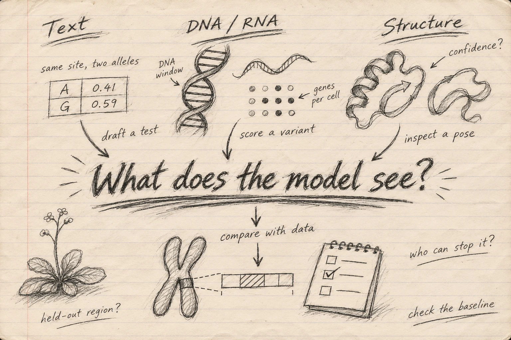

*Genomes to AI · Methods notebook · December 2025*

*Revised 12 November 2026 with a worked example from my plant-genomics workflow and an afterword on medical AI and governance.*

I can ask ChatGPT to write a script that joins genomic variants to model scores. The script might run on the first attempt. The scatterplot might even look convincing. Then comes the question I would ask of a student's plot, or of my own. **Are those actually the same alleles?**

A join on chromosome and position can silently attach a score for C→G to a C→T variant. Every downstream calculation can be correct for the resulting table. The biological interpretation is already wrong.

By “see” I mean **the information the model actually receives for this prediction**. Imagine one variant in an *Arabidopsis* gene. ChatGPT could read my question and the rows I paste. GPN could receive the DNA letters surrounding the site. A single-cell model could receive an expression profile from a root cell. AlphaFold 3 could receive the sequence of the encoded protein and its proposed partner. Even when the examples all concern the same gene, the models are working with different observations. If I want to know whether the variant affects how plants survive a dry summer, I still need a study that measures survival in the relevant environments.

{fig-alt="Dark graphite sketch on warm ruled notebook paper. Handwritten notes link a text prompt, a DNA window and genes per cell, and a molecular pose to checks against independent data."}

## Begin with the research question

Here is a question I can work with as a population geneticist. *Do plant variants with large allele-frequency changes tend to receive less favourable DNA model scores than comparable variants?* Before opening a chat window, I would write down the reference assembly, the definition of a frequency change, the comparison set and the outcome I would report. A workable comparison might use variants with similar starting allele frequency, coverage and annotation, and use genomic blocks to account for linkage. Which variants count as comparable depends on whether I am asking about predictability or about an evolutionary process.

A sequence score and a frequency change answer different questions. Sequence context can inform a hypothesis about functional constraint. A temporal frequency shift also reflects sampling, drift, demography and selection. If the question is whether drift can explain an observed shift, the appropriate first comparison is a drift model with explicit sampling and demographic assumptions. The sequence score can then help ask whether departures from that model have a biological pattern.

Lisa Messeri and M. J. Crockett describe how AI can give researchers a sense of understanding that exceeds the evidence available. A reliable prediction can feel like a causal explanation. Screening millions of variants can feel comprehensive even if all candidates are filtered through one model's assumptions. A numerical score can look objective even when reference choices, training data and evaluation labels shape it. The authors connect those illusions to a broader concern about scientific monocultures. If many labs use the same model and proxy, agreement can reflect a common method. In my example, a drift simulation and an independent assay offer different checks from scoring the same sequence with a second model. [Messeri & Crockett, *Nature* (2024)](https://doi.org/10.1038/s41586-024-07146-0).

## How to write a scientific ChatGPT prompt

I write a scientific prompt the way I would brief a colleague who is seeing the project for the first time. I start with a decision I can make after reading the answer. Then I supply the pieces of evidence and the conventions that a colleague would otherwise have to ask me about. A good test of the prompt is whether I can tell in advance what a wrong answer would look like.

| Step | What to specify | In the example below |
|---|---|---|
| **1. State the decision** | Give the research question and the next action the answer should inform. | Decide whether two score–frequency summaries can be compared. |
| **2. Provide the evidence** | Supply a small input, relevant code or passages, and the provenance of each. | Provide a table with SNPs retained in each run. |
| **3. Define the comparison** | Set the unit of analysis, reference, allele orientation, score units, filters and statistic. | One row per SNP, the same derived allele, and Pearson correlation on shared rows. |
| **4. Request an inspectable output** | Ask for a table, script or patch with named fields and a clear scope. | Request row counts, correlations and a runnable check. |
| **5. Give a known answer** | Include one expectation you can verify yourself and one failure case. | A positive rescaling preserves Pearson correlation on the same rows. A one-row tail has no correlation. |
| **6. Specify how to handle missing evidence** | Ask what was run, which assumptions remain open and which conclusions the result supports. | Identify missing metadata and explain what the toy example can establish. |

### A worked prompt from a plant-genomics chat

In a discussion about my *Arabidopsis lyrata* benchmark, I asked why an earlier plot of GPN scores against derived allele frequency looked stronger. There were several plausible explanations. The two runs could retain different SNPs, summarise single SNPs versus bins of frequency, or use different score conventions. “Explain the stronger relationship” invites a story before those possibilities have been checked. Here is how I would pose the same question with invented data and a known answer.

```text
Decision
I want to know whether two GPN–frequency summaries are directly comparable.
Audit the data and statistic first. Use only the synthetic table below.

Data and conventions
One row is one already harmonised biallelic SNP on a single reference.
DAF is derived allele frequency in the same sample in both runs.
In this fixture the derived allele is ALT for every SNP. A score is the
base-10 log likelihood ratio for ALT relative to REF. Run B represents
the same scores in natural-log units, multiplying by ln(10).
keep_A and keep_B indicate whether that SNP survived each run's filters.

snp,score_log10,DAF,keep_A,keep_B
s1,-1.0,0.02,1,1
s2,-0.8,0.06,1,1
s3,-0.5,0.10,1,1
s4,-0.2,0.20,1,1
s5,0.0,0.18,1,1
s6,-1.4,0.01,1,0
s7,-1.4,0.40,0,1

Output
Provide a short runnable R or Python script and a table of n and Pearson r.
Calculate each run on its own SNPs, then repeat on the exact shared SNPs.
On the shared set, count the negative scores and take the lowest 25% of
those scores, rounding the count up. Include cutoff ties if there are any.
Report when r is undefined. Keep zero in the full-set analysis.

Checks and interpretation
Expect six SNPs in each run and five shared. Verify that converting score
units alone leaves r unchanged on the shared rows. Explain why a plot of
bin means cannot be compared directly with a per-SNP r.
For a real rerun, list the metadata and code needed to match the earlier
analysis. State what you executed and what you verified by inspection.
```

On the five shared SNPs, both runs give the same Pearson correlation. Multiplying all scores by the same positive constant changes their units and leaves that correlation unchanged. Including the two different run-specific SNPs changes the result because the most negative score is paired with a rare allele in one run and a common allele in the other. The shared set has four negative scores, so the tail contains one SNP and its correlation is undefined.

| Analysis | SNPs | Run A, Pearson $r$ | Run B, Pearson $r$ |
|---|---:|---:|---:|
| Each run's own SNPs | 6 per run | 0.948 | −0.265 |
| Same shared SNPs | 5 per run | 0.961 | 0.961 |
| Lowest quarter of shared negative scores | 1 per run | Undefined | Undefined |

<details>
<summary>Reproduce the toy results in Python</summary>

```python
from math import ceil, log
from statistics import correlation

# Columns match the synthetic table in the prompt, in the same order.
snps = [
    ("s1", -1.0, 0.02, True, True),
    ("s2", -0.8, 0.06, True, True),
    ("s3", -0.5, 0.10, True, True),
    ("s4", -0.2, 0.20, True, True),
    ("s5",  0.0, 0.18, True, True),
    ("s6", -1.4, 0.01, True, False),
    ("s7", -1.4, 0.40, False, True),
]


def summarize(rows, scale):
    scores = [row[1] * scale for row in rows]
    frequencies = [row[2] for row in rows]
    if len(set(scores)) < 2 or len(set(frequencies)) < 2:
        return len(rows), "undefined"
    return len(rows), f"{correlation(scores, frequencies):.3f}"


run_a = [row for row in snps if row[3]]
run_b = [row for row in snps if row[4]]
shared = [row for row in snps if row[3] and row[4]]
negative_scores = sorted(row[1] for row in shared if row[1] < 0)
cutoff = negative_scores[ceil(len(negative_scores) / 4) - 1]
tail = [row for row in shared if row[1] <= cutoff]

print("A only its retained SNPs", summarize(run_a, 1))
print("B only its retained SNPs", summarize(run_b, log(10)))
print("Shared SNPs, A and B", summarize(shared, 1), summarize(shared, log(10)))
print("Shared negative tail, A and B", summarize(tail, 1), summarize(tail, log(10)))
```

</details>

Binning answers a different question again. It averages over variation within each bin, and a correlation of bin means gives each bin one point regardless of how many SNPs it contains. For the real analysis I would freeze the SNP intersection, verify which allele the score describes, recover the old binning and tail rules, and use genomic blocks to account for linkage when estimating uncertainty.

### A prompt I would use for a GitHub script

Give ChatGPT the relevant function, the README section that defines the inputs, and a small public or synthetic example. A repository link is useful for orientation. The exact revision and the relevant code are what make a proposed edit reviewable. If the chat has repository access, ask it to cite the files and lines it actually inspected.

```text
Goal
Review the join that attaches plant DNA-model scores to biallelic SNVs.

Evidence
Use the README, existing join function and synthetic input shown below.
Repository revision: [commit SHA]. Reference assembly: [assembly accession].
Both inputs use 1-based genomic positions and the forward reference strand.
The join key is (chrom, pos, ref, alt). A second ALT can occur at the same site.

Deliverable
First describe the current behaviour with file and line references.
Then propose a minimal patch, a runnable check and its expected output.
Preserve input row order. Count unmatched rows and keep their scores missing.
Fail on duplicate score keys. Keep a numerical zero as a valid score.

Verification
Show cases for two ALTs at one position, a REF mismatch, a duplicate key
and a true zero. Explain which check verifies the FASTA reference base and
which check only verifies the join. List any assumptions you could not verify.
Report which commands you actually ran and their exit status.
```

A second prompt can be shorter. “Review the patch against the original contract. Identify the first fixture that would fail and explain why.” I run that fixture myself. A second chat can offer another reading, but two agreeing chat responses still leave the software untested.

### A prompt for literature, statistics or a manuscript

```text
Using the papers and excerpts I provide, assess the claim:
"Lower DNA-model scores explain the observed temporal allele-frequency shifts."

Return a table with claim, source or result, evidence type, alternative
explanation, and a sentence supported by the evidence. Separate published
results, my observations and proposed hypotheses. For published results,
identify the figure, table or passage supporting each claim. If a source
does not establish the claim, show which part remains unresolved.
For each suggested statistical check, state the unit of replication,
the comparison group and one outcome that would weaken the claim.
```

For a methods edit, I supply the actual command, software version, settings and exclusions, then compare the edited paragraph with the run record. For debugging, I supply the smallest failing example and its expected behaviour. For literature discovery, I verify the DOI and the figure, table or passage behind each claim. Joe Slater, James Humphries and Michael Townsen Hicks argue in *Scientific American* that the word “hallucination” can obscure how fluent text gets mistaken for a truth-seeking account and who is responsible when that text is used. A real citation attached to a claim it never tested is a good example. The DOI can resolve perfectly while the sentence still needs correction. [Slater, Humphries & Hicks, *Scientific American* (2024), opinion](https://www.scientificamerican.com/article/chatgpt-isnt-hallucinating-its-bullshitting/).

## Take the script from chat to GitHub

Here is a runnable, dependency-free fixture for the join. It uses invented contig names and precomputed scores. The input contains two different ALTs at position 42, a different REF at the same coordinate and a true zero. Copy it into a temporary Python file and run it with Python 3.10 or newer.

```python
from math import isfinite

Variant = tuple[str, int, str, str]


def attach_scores(
    variants: list[Variant],
    score_rows: list[tuple[Variant, float]],
) -> list[tuple[Variant, float | None]]:
    scores = {}
    for key, score in score_rows:
        if key in scores:
            raise ValueError(f"Duplicate score key: {key}")
        if not isfinite(score):
            raise ValueError(f"Non-finite score: {key}")
        scores[key] = score

    return [(key, scores.get(key)) for key in variants]


variants = [
    ("toy1", 42, "C", "T"),
    ("toy1", 42, "C", "G"),
    ("toy1", 42, "A", "T"),
    ("toy1", 77, "G", "A"),
]
score_rows = [
    (("toy1", 42, "C", "G"), -1.2),
    (("toy1", 42, "C", "T"), 0.0),
    (("toy1", 77, "G", "A"), 0.4),
]

result = attach_scores(variants, score_rows)
assert [key for key, score in result] == variants
assert [score for key, score in result] == [0.0, -1.2, None, 0.4]
assert sum(score is None for key, score in result) == 1

try:
    attach_scores(variants, score_rows + [score_rows[0]])
except ValueError as error:
    assert "Duplicate score key" in str(error)
else:
    raise AssertionError("Duplicate score key was accepted")

print("4 variants, 3 matched, 1 unmatched; duplicate rejected.")
```

The fixture isolates the join. In a real workflow I would check each REF against the exact indexed FASTA before scoring or merging, and log reference mismatches separately from valid variants with no score. Here, the row with REF A exercises the **join** behaviour. A production preflight on a FASTA with C at position 42 should reject it earlier. I would record assembly and annotation accessions and checksums, normalise variants where needed, define how multi-allelic sites are handled, and reconcile contig naming and coordinate conventions explicitly. A 1-based single-site coordinate $p$ becomes the BED interval $[p-1,p)$. Agreement between two tables can still be wrong if both are on the same wrong assembly.

A GitHub pull request is where I want the scientific assumptions to become visible. Start from a named commit and create a branch. Read the diff, run the small check and the repository's existing tests, and compare row counts before and after the change. In the pull request record the input contract, the edge cases exercised, the command and outcome, and any changes to the denominator. Keep the toy data and expected output alongside the code when they protect a specific regression. For a result others should reproduce, link to the commit or release, and record the software environment, model checkpoint or revision, reference checksums, parameters and seeds. For a Slurm or GPU run, capture the submitted script and logs. A 20-row smoke test can expose path, dependency and format problems before a full run. Use public or invented inputs for examples and keep restricted data and credentials out of prompts and public commits. [GitHub documentation on permanent file links](https://docs.github.com/en/repositories/working-with-files/using-files/getting-permanent-links-to-files).

## What each model sees

A foundation model learns patterns during pretraining, then reuses them for downstream tasks. When I use a fixed DNA model to score a plant SNP without fitting it to labelled examples of that task, that is **zero-shot** use. When I update a model with labelled splice sites or cell types, I am **fine-tuning** it. I could also keep the model fixed and train a small classifier on its output. That classifier still uses labels. In each case, the test needs to match the claim. To claim that a classifier works in another experiment, I would reserve whole experiments for testing, so it cannot succeed by recognising a batch it saw during training.

| Model | What I give it | What it can return | What I would check separately |
|---|---|---|---|
| **ChatGPT · text and code** | A prompt, the join function and two rows at position 42 with different ALT alleles. | A patch and a test that should attach each score to the correct row. | Run the fixture and inspect the full diff against the repository's input contract. |
| **GPN / PlantCAD · genomic DNA** | A DNA window around a C→T variant, with the focal base masked for masked-base scoring. | A relative score for the two bases in that context. A separately fitted PlantCAD task head can score candidate splice sites. | Ask whether low-scoring alleles are enriched among rare variants after accounting for annotation, population structure and sampling. |
| **Geneformer / scGPT · single-cell expression** | Genes and RNA abundance from one cell, encoded as ranks or expression values according to the model. | A numerical summary of the cell, or a cell-type label from a model fitted for annotation. | Check the label against markers and test it on cells from an independent sample. |
| **AlphaFold 3 · molecular structure** | The amino-acid sequence of an *Arabidopsis* DNA-binding protein and a specified DNA sequence. | A candidate arrangement of protein and DNA, with confidence estimates. | Check the placement of the two chains and compare the proposed contact with independent binding or structural data. |

For **ChatGPT**, the two rows are data because I supplied them. If I provide only a screenshot of a scatterplot, the answer cannot determine which rows went into the calculation. I can make the answer checkable by supplying the underlying table or asking for a command I can run to recover it. For a model with tool access, I would still ask which file, revision and command it actually used.

The *Science* paper on **Evo** makes a different point about what a model can see. Its long sequence context lets it consider DNA at scales ranging from parts of genes to much larger genomic regions. The authors report that the model learned signals related to how mutations affect function at several molecular scales. The original training data came primarily from prokaryotic and phage genomes. For an *Arabidopsis* SNP, I would test whether a longer window adds predictive value using a plant-relevant baseline and a plant test set. Context length and evidence of transfer are separate properties. [Nguyen et al., *Science* (2024)](https://doi.org/10.1126/science.ado9336).

### DNA · GPN and PlantCaduceus

**GPN** learned from the unaligned reference genomes of *Arabidopsis thaliana* and seven other Brassicales species. It learns to predict a hidden DNA base from its neighbours. Benegas and colleagues evaluated the scores with population allele frequencies and trait-association data in *A. thaliana*. Those are two complementary checks. An allele-frequency pattern can be consistent with constraint, and a trait association can help prioritise a region. Establishing that the scored SNP is the causal variant takes additional evidence. [Benegas, Batra & Song, *PNAS* (2023)](https://doi.org/10.1073/pnas.2311219120).

**GPN-MSA** adds aligned DNA from other species. Imagine that the neighbouring letters make both C and T plausible, while a well-aligned position carries C across several related genomes. The alignment gives the model comparative evidence about that position. The authors evaluated predictions for human variants in coding and noncoding regions. In a comparison with phyloP, I would check how much comparative information the methods share and whether both depend on the same uncertain alignment. [Benegas et al., *Nature Biotechnology* (2025)](https://doi.org/10.1038/s41587-024-02511-w).

**PlantCaduceus**, or **PlantCAD**, was pretrained on 16 flowering plant genomes. Zhai and colleagues showed that models fine-tuned on annotated *Arabidopsis* sites could transfer to maize for tasks such as identifying splice junctions and translation boundaries. The paper also evaluated zero-shot variant scores. Suppose a SNP sits beside a splice donor. I could use a sequence score to rank the candidate and a splice-site classifier to ask a more targeted question about the junction. To see whether the plant uses that junction differently, I would look for RNA reads spanning the relevant junctions. [Zhai et al., *PNAS* (2025)](https://doi.org/10.1073/pnas.2421738122) · [PlantCAD implementation](https://github.com/plantcad/plantcad).

For a masked-base model, one explicitly defined score is $\log_{10}[P(\mathrm{ALT}\mid\mathrm{context})/P(\mathrm{REF}\mid\mathrm{context})]$. If $P(\mathrm{ALT})=0.05$ and $P(\mathrm{REF})=0.50$, the score is $-1$. The model assigns the alternate one tenth the probability of the reference in that window. The ratio tells me about sequence compatibility under that checkpoint. It has no units of fitness. REF and ALT describe the reference assembly and variant record. An evolutionary analysis that needs ancestral and derived states requires a separate polarisation step. I would also check the native scoring convention, context length, reverse-complement handling and treatment of ambiguous bases before comparing models.

To ask whether the DNA model adds information, I would define a target first. With independently validated variants and credible controls, compare ranking performance with an annotation-only baseline and, when available for the species and build, phyloP or GERP. Examine the change in precision among the number of candidates the lab can follow up. Use held-out chromosomes or genomic blocks where nearby windows and linkage would otherwise cross splits, and group close homologues when testing transfer across genes or species. A block bootstrap can express uncertainty around the gain. If the only outcome is rare-allele enrichment, report it as a population-genetic proxy and consider demography, coverage and ascertainment. If a conservation baseline and a DNA model agree, they may be reading partly shared evolutionary information.

For a public practice run, I would take a small set of biallelic SNVs from the *A. thaliana* 1001 Genomes release, verify the TAIR10 REF alleles, and compare score distributions across prespecified annotation and allele-frequency strata. The consortium sequenced 1,135 naturally inbred lines and found geographic structure consistent with a history of glacial refugia and later expansion. In a pooled sample, an allele common in a small regional group can look rare overall. I would therefore examine the pattern within well-sampled groups. GPN already used this panel for evaluation, making the exercise a check on reproducibility. [1001 Genomes Consortium, *Cell* (2016)](https://doi.org/10.1016/j.cell.2016.05.063) · [Public variant release](https://1001genomes.org/data/GMI-MPI/releases/v3.1/).

### RNA · Geneformer and scGPT

Take two cells from a single-cell RNA-seq experiment. One expresses several markers of a cell type, while the other expresses a mixture of those markers and a stress-response programme. What the model receives is a processed record of transcripts detected in each cell. The question of whether the second cell is stressed, belongs to another cell type, or reflects sample handling still depends on the experimental design.

**Geneformer** ranks genes within each cell after accounting for how commonly expressed those genes are in its reference corpus. The original model was pretrained on about 30 million human single-cell transcriptomes. Theodoris and colleagues used it to prioritise candidate regulators in cardiomyopathy and followed up selected predictions experimentally. That progression is worth paying attention to. A simulated change in the cell representation can help select a candidate, and a follow-up experiment can test whether manipulating the candidate affects the phenotype. [Theodoris et al., *Nature* (2023)](https://doi.org/10.1038/s41586-023-06139-9).

**scGPT** encodes gene identities alongside expression information. Cui and colleagues pretrained it on more than 33 million cells and evaluated downstream tasks such as cell-type annotation, batch integration and perturbation prediction. Those tasks can pull in different directions. For example, an embedding that aligns two batches may also blur a genuine biological difference if each batch corresponds to a different condition. I would check both batch mixing and preservation of cell-type or treatment signals. For either model, applying a human-trained checkpoint to plants would require a species and gene-vocabulary audit. If I map orthologues, I would report what was lost or duplicated and whether the marker genes I care about survived. [Cui et al., *Nature Methods* (2024)](https://doi.org/10.1038/s41592-024-02201-0).

Suppose I want to annotate a plant root cell state across experiments. I would compare the embedding against PCA followed by a simple classifier or marker-based annotation. I would split by plant or experiment before fitting the preprocessing and classifier, keep rare states visible with per-class metrics or macro-F1, and examine whether errors cluster by batch or tissue. If asking whether a cell state changes with treatment, I would retain the biological replicate as the unit of inference, for example with replicate-level pseudobulk counts within cell types where appropriate. Cells from one plant are subsamples. A clean embedding cannot supply missing replication.

For gene perturbation prediction, Ahlmann-Eltze and colleagues found that the tested deep-learning approaches did not outperform simple linear baselines in their comparisons. Consider predicting what happens when two genes are perturbed together. A natural baseline adds the changes observed for each gene on its own. To claim that a more complex model learns interactions, I would test it on held-out gene pairs and ask whether it predicts the departures from additivity. An embedding that organises known cell types has passed a different test. [Ahlmann-Eltze, Huber & Anders, *Nature Methods* (2025)](https://doi.org/10.1038/s41592-025-02772-6).

### Structure · AlphaFold 3

Josh Fischman's account of the 2024 chemistry Nobel Prize distinguishes two achievements. Demis Hassabis and John Jumper were recognised for protein structure prediction, illustrated by AlphaFold 2. David Baker was recognised for computational protein design. One task starts with a sequence and asks how it might fold. The other can start with a desired structure or property and search for a sequence that can realise it. That distinction also helps when reading claims about newer systems. [Fischman, *Scientific American* (2024), reporting](https://www.scientificamerican.com/article/chemistry-nobel-2024/).

**AlphaFold 3** uses a diffusion-based architecture to predict a joint arrangement of supplied molecular components. Abramson and colleagues reported improvements over specialised tools on several classes of interactions, including protein–ligand and protein–nucleic acid complexes. Suppose I supply a plant transcription factor and a candidate DNA motif. The result proposes where the protein might sit on that piece of DNA. The inputs already specify which molecules to consider. Asking which motif the protein prefers, or whether it binds in a root cell, requires a comparison with other motifs or evidence from the cell. [Abramson et al., *Nature* (2024)](https://doi.org/10.1038/s41586-024-07487-w) · [AlphaFold 3 output documentation](https://github.com/google-deepmind/alphafold3/blob/main/docs/output.md).

```{=html}
<figure class="figure">
<svg viewBox="0 0 640 244" width="640" role="img" aria-labelledby="pose-title pose-desc" style="display:block;max-width:100%;height:auto;margin:auto;background:#fff">
  <title id="pose-title">Three molecular components in one predicted complex</title>
  <desc id="pose-desc">A wavy protein line, a two-stranded DNA ladder and a small molecule ring are shown together. Thin leader lines identify each component.</desc>
  <g fill="none" stroke="#343434" stroke-linecap="round" stroke-linejoin="round">
    <path stroke-width="6" d="M223 150q-49-24-19-52t58 9q33 42 49 5t35-28q32 7 12 38t-31 41q-11 20 26 22"/>
    <path stroke-width="3" d="M262 57q35 11 62 2t62-7q39 2 60 10M262 77q34 8 63 0t60-7q37 2 61 11"/>
    <path stroke-width="2" d="M277 62v17m18-16v17m18-18v17m18-22v18m18-22v17m18-20v19m18-19v19m18-17v19m18-14v18"/>
    <path stroke-width="3" d="M375 105l15-8 14 8v17l-14 8-15-8z"/>
    <path stroke-width="1.5" d="M99 147l81-18m290-86-26 12m20 89-56-23"/>
  </g>
  <g fill="#252525" font-size="19" font-family="system-ui, sans-serif">
    <text x="27" y="153">Protein</text>
    <text x="479" y="47">DNA</text>
    <text x="472" y="152">Small molecule</text>
  </g>
</svg>
<figcaption class="figure-caption">Three components in a predicted complex. Adapted from Fig. 1a of Abramson et al., <i>Nature</i> (2024). Redrawn as a simplified schematic with generic shapes. <a href="https://doi.org/10.1038/s41586-024-07487-w">Original article</a> · <a href="https://creativecommons.org/licenses/by/4.0/">CC BY 4.0</a>.</figcaption>
</figure>
```

For a plant protein complex, I would start with a known isoform and a specific structural question. For instance, where does a naturally occurring residue lie relative to a proposed interface? I would inspect local confidence (pLDDT), the predicted aligned error (PAE) across the relevant chains and, where appropriate, interface confidence (ipTM). Strong local confidence for two folded domains can coexist with uncertain placement between them. I would compare plausible alternatives, record the inputs and seeds, and check experimentally solved homologues when available. A pose can suggest a contact worth following up. Binding affinity, the direction of an allelic effect and interaction in a living cell require their own evidence.

## Afterword · What would count as medical AI superintelligence?

*Added 12 November 2026.*

In *Toward a test of medical AI superintelligence*, Ethan Goh and colleagues propose a demanding comparator. A system would need to outperform teams of top specialists across clinically meaningful tasks. A curated exam question starts with a case someone has already assembled. In a clinic, relevant information can be missing, the record can change, and recognising when to ask for help can matter as much as naming a diagnosis. The accompanying Medical AI Superintelligence Test (MAST) evaluates capabilities such as diagnosis, management, imaging and safety, with held-out cases to protect the evaluation. I would read the results task by task. A system could perform strongly on imaging while missing dangerous management errors. To decide whether using it improves care, I would want evidence from the workflow in which it would be used, including how clinicians respond to its advice and what happens to patients. The paper proposes a way to measure progress towards a capability. [Goh et al., *Nature Medicine* (2026)](https://www.nature.com/articles/s41591-026-04539-8) · [ARISE, MAST framework](https://www.arise-ai.org/blog/mast).

### Who controls superintelligent systems?

I would start with a more concrete question. **Who can authorise the system to act, and who can stop it?** Consider two uses of a medical AI system. In one, it drafts a note that a clinician reviews and signs. In the other, its output changes a patient's place in a triage queue. The second use changes what happens to a patient before anyone reads the reasoning. It calls for its own evidence, clear limits on what the system may do, and a named person or team that can override it. A person asked to approve a long list of outputs needs enough time, access to the source information and the authority to disagree.

Control is distributed. Developers control training and releases. Hospitals or other deploying institutions decide where the system runs, which tools and data it can access, and who can suspend it locally. Independent evaluators need enough access to reproduce relevant checks and report failures. Public authorities can set oversight requirements, and affected people need a way to challenge a decision. In a hospital, I would ask who can pause the triage system if staff identify a pattern of missed urgent cases, whether the previous workflow can be restored, and who reviews the incident before restart. At the frontier, the same questions apply to permissions, model updates and access to evaluations. The *International AI Safety Report* describes practices such as testing before release, conditional safeguards and incident reporting. It also notes how limited the evidence is on whether these practices reduce risk in real deployments. [International AI Safety Report (2026)](https://internationalaisafetyreport.org/publication/international-ai-safety-report-2026).

## What would change my mind?

Return to the plant variant at the beginning. The first check is mundane. Does the score belong to the right allele? Then I want to know whether it improves on a baseline on held-out data, and whether the result survives matching for starting frequency and annotation. Expression or structure might suggest a mechanism for a particular candidate. I would keep those lines of evidence separate and ask which observations are genuinely independent.

For a first attempt, I would take one research script, write a small fixture with a deliberately wrong answer, and use ChatGPT to help make the failure visible. Then I would try one fixed scientific model on one public dataset, beside one simple baseline. Save both outcomes, including cases where the model adds little. That gives the next person something to rerun and something to disagree with.

The margin of the sketch says “check the baseline”. If a model is only proposing a research candidate, I can test that candidate before I act on it. If its output is already changing a workflow, I also need to know who will notice a failure and who can reverse the decision. In either setting, I want to be able to answer one question before seeing the result. **What evidence would make me change my mind?**
