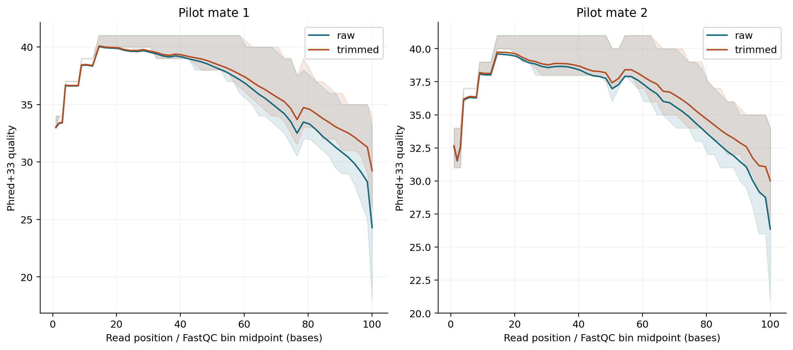
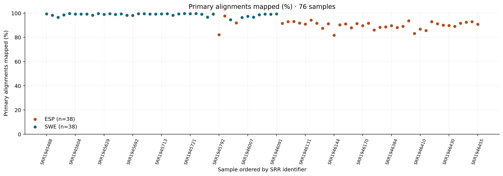
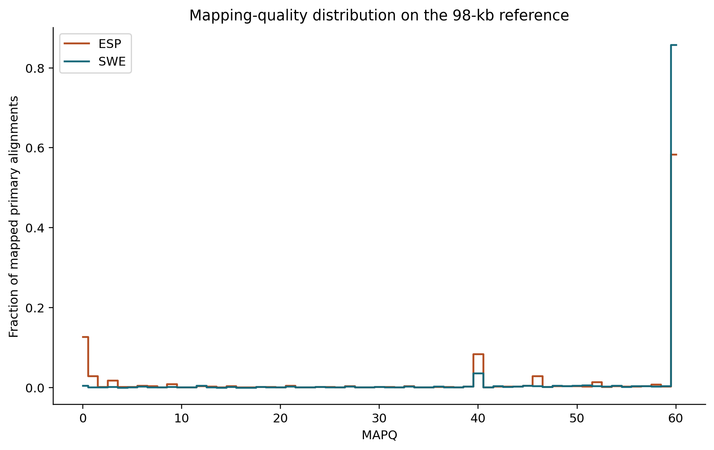
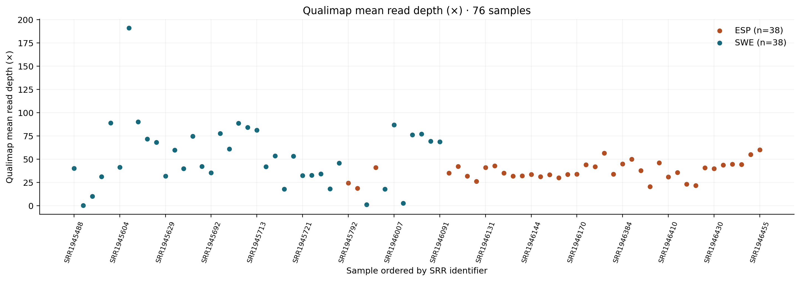
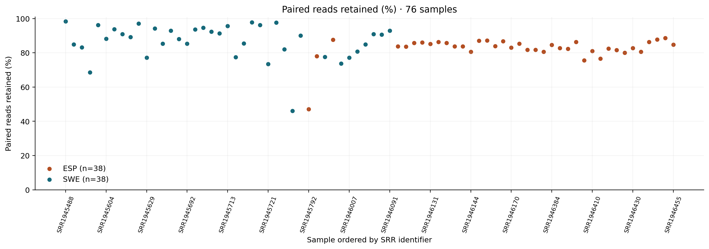

---
title: "QBio305 Population Genetics — Practical Day 1: FASTQ quality control and read mapping"
author: "Dr Tahir Ali | AG de Meaux"
format:
  html:
    toc: true
    toc-depth: 2
    toc-location: right
    code-copy: true
    code-fold: false
    code-overflow: scroll
---

```{=html}
<style>
#quarto-document-content,
main.content {
  min-width: 0;
}
main.content div.sourceCode,
#quarto-document-content div.sourceCode {
  max-width: 100%;
  min-width: 0;
  overflow-x: auto !important;
  box-sizing: border-box;
}
main.content pre,
#quarto-document-content pre {
  max-width: 100%;
  overflow-x: auto;
  box-sizing: border-box;
}
main.content pre code,
#quarto-document-content pre code {
  white-space: pre;
  overflow-wrap: normal;
}
</style>
```

*QBio305 Population Genetics · University of Cologne*

**Aim:** Starting with paired-end FASTQ files, examine read quality, trim low-quality sequences, map reads to a reference genome and evaluate the resulting alignments.

The scripts process **all available sample pairs by default**. Students may optionally select one sample to practise with a smaller dataset. All required software is already available on RAMSES.

[RAMSES login and RStudio guide](ramses-rstudio-guide.html) · [Practical Day 2](practical_day2.html)

## What you will learn

1. Access the RAMSES HPC system and locate sequencing files.
2. Understand the structure of FASTQ records.
3. Assess read quality using FastQC and MultiQC.
4. Trim reads with Trimmomatic.
5. Map paired-end reads using BWA and SAMtools.
6. Evaluate mapping quality, read depth and read retention.
7. Interpret computational results in a biological context.

# 1. Connect to RAMSES

Follow the [RAMSES login guide](ramses-rstudio-guide.html) to configure your SSH key, VPN and authentication.

**Mac Terminal**

Replace `YOUR_USERNAME` with your own RAMSES account:

```bash
ssh -i ~/.ssh/ramses_YOUR_USERNAME \
  -o IdentitiesOnly=yes \
  YOUR_USERNAME@ramses4.itcc.uni-koeln.de
```

**Windows**

Open MobaXterm → Session → SSH.

Use `ramses4.itcc.uni-koeln.de`, your assigned username and your private SSH key under Advanced SSH settings.

At login, enter the current six-digit verification code from Google Authenticator. A previously used or expired code may not be accepted.

Check your identity and working directory:

```bash
whoami
pwd
```

## Copy the course data

The input data are already available on RAMSES. Copy them into your home directory only if they are not already present:

```bash
if [ ! -d "$HOME/sample_project_data" ]; then
  cp -a \
    /scratch/QBIO_WS27/teaching_inputs/day1/sample_project_data \
    "$HOME/"
fi

ls "$HOME/sample_project_data/fastq" | head
```

You should see paired files such as:

```text
SRR1945488.Chr4_repair_1.fastq.gz
SRR1945488.Chr4_repair_2.fastq.gz
```

Do not edit the original input FASTQ files.

## Create the practical directories

Run this before creating or submitting any script:

```bash
mkdir -p "$HOME/Practical_Day_1"/{scripts,fastqc,trimming,mapping,bamqc,logs,figures}
mkdir -p "$HOME/Practical_Day_1/fastqc/trimmed"

cd "$HOME/Practical_Day_1"
pwd
```

Your directory structure will contain:

| Directory | Purpose |
|---|---|
| `scripts/` | Bash and Python scripts |
| `fastqc/` | Raw and trimmed read-quality reports |
| `trimming/` | Trimmed FASTQ files |
| `mapping/` | Reference, BAM and mapping summaries |
| `bamqc/` | Qualimap reports |
| `figures/` | Generated PNG figures |
| `logs/` | SLURM job output and error messages |

**Important:** Always create and submit your scripts from `Practical_Day_1`. Script files belong inside its `scripts/` directory.

# 2. Software and SLURM

All required software is installed on RAMSES. No installation is needed.

Activate the course environment when using SAMtools, Python or other course software interactively:

```bash
module avail Miniconda
module load lang/Miniconda3

source "$(conda info --base)/etc/profile.d/conda.sh"

conda activate /scratch/QBIO_WS27/envs/qbio_popgen_ws27

samtools --version | head -n 1
```

To inspect available software modules:

```bash
module avail bio/FastQC
module avail bio/Trimmomatic
module avail bio/BWA
module avail bio/MultiQC
```

Do not load all modules simultaneously. Some use different Java or compiler versions. Each SLURM script loads the specific module it needs.

## How to create scripts using nano

Before every script, use its specified `nano` command.

For example:

```bash
nano "$HOME/Practical_Day_1/scripts/fastqc.sh"
```

Paste the complete code into the editor.

Save using **Ctrl + O**, press **Enter**, and exit with **Ctrl + X**.

Submit Bash scripts using `sbatch`; run Python plotting scripts with the preinstalled course Python.

## All samples versus one sample

**Default: all available samples**

```bash
cd "$HOME/Practical_Day_1"
sbatch scripts/fastqc.sh
```

**Optional: only the example sample**

```bash
cd "$HOME/Practical_Day_1"

sbatch \
  --export=ALL,QBIO_SAMPLE=SRR1945488.Chr4_repair \
  scripts/fastqc.sh
```

The same sample-selection option works for trimming, trimmed FastQC, BWA and Qualimap.

For Python scripts, use:

```bash
QBIO_SAMPLE=SRR1945488.Chr4_repair \
  /scratch/QBIO_WS27/envs/qbio_popgen_ws27/bin/python \
  scripts/plot_mapq.py
```

Omit `QBIO_SAMPLE` to process all completed samples.

## Monitor a SLURM job

```bash
squeue -u "$USER"
```

After submitting a job, record the displayed job ID. To confirm whether it completed successfully:

```bash
sacct -j YOUR_JOB_ID --format=JobID,State,ExitCode,Elapsed
```

An empty `squeue` output means the job is no longer queued or running; it does not by itself confirm success.

# 3. Examine a FASTQ file

FASTQ is the standard format for sequencing reads and their associated quality scores.

```bash
cd "$HOME/sample_project_data/fastq"

zcat SRR1945488.Chr4_repair_1.fastq.gz | head -n 8
```

Example output from the student test (quality lines shortened for display):

```text
@SRR1945488.595/1
AGTAGACGAATAACATAAAACTTTTTTTGAAAAATAAAATAATGGTTGAGTGAATCATTACACGTTCGGATTGGTTATGAATAGCAGTAGCTCTGCTTCT
+
CCCFFFFFGHFGHJ@FIJJJJJJJJJJJEHIIGGIJIJJIIJJJJGIJDHFHGGHGIIHGCEEC...
@SRR1945488.993/1
CCCTTCTGAAAGGTCACATCCGTTCCTTGTATCCTTCCAAAAGGTCACATCCGTTCCTTGCATCTATTAGGCGATGCAACCGTTCGTTGGTACCCGCTCC
+
CCCFFFFFHHHHHHIIJJJJJIIJJJJJIJJJIJJIIIJJIIIHGIIJJGHHJHH...
```

Each FASTQ record contains four lines:

1. Read identifier, beginning with `@`.
2. DNA sequence.
3. A `+` separator.
4. Base-quality characters encoding Phred quality scores.

Count the number of lines:

```bash
zcat SRR1945488.Chr4_repair_1.fastq.gz | wc -l
```

Observed output:

```text
94888
```

Each read has four lines, so the number of reads is:

\[
94888 / 4 = 23722
\]

The example file therefore contains **23,722 reads**.

**Question:** Why is it important to evaluate base quality before aligning sequencing reads to a reference genome?

# 4. FastQC and MultiQC

## FastQC

Create the script:

```bash
nano "$HOME/Practical_Day_1/scripts/fastqc.sh"
```

Paste:

```bash
#!/bin/bash -l
#SBATCH --job-name=qbio-fastqc
#SBATCH --account=kurse
#SBATCH --partition=smp
#SBATCH --nodes=1
#SBATCH --ntasks=1
#SBATCH --cpus-per-task=4
#SBATCH --mem=10G
#SBATCH --time=04:00:00
#SBATCH --output=logs/fastqc-%j.out
#SBATCH --error=logs/fastqc-%j.err

set -euo pipefail

mkdir -p "$HOME/Practical_Day_1/fastqc"

module purge
module load bio/FastQC/0.12.1-Java-11

INPUT="$HOME/sample_project_data/fastq"
OUT="$HOME/Practical_Day_1/fastqc"

shopt -s nullglob
count=0

for r1 in "$INPUT"/*_1.fastq.gz; do
  sample=$(basename "$r1" _1.fastq.gz)

  [[ -z "${QBIO_SAMPLE:-}" || "$sample" == "$QBIO_SAMPLE" ]] || continue

  r2="$INPUT/${sample}_2.fastq.gz"

  [[ -f "$r2" ]] || {
    echo "Missing R2: $sample" >&2
    continue
  }

  fastqc --threads 4 --outdir "$OUT" "$r1" "$r2"
  count=$((count+1))
done

(( count > 0 )) || {
  echo "No matching read pairs found" >&2
  exit 1
}

echo "FastQC completed for $count samples"
```

Save using **Ctrl + O**, **Enter**, then **Ctrl + X**.

Submit:

```bash
cd "$HOME/Practical_Day_1"

sbatch scripts/fastqc.sh

squeue -u "$USER"
```

Once complete, the `fastqc/` directory contains individual HTML and ZIP reports for each processed FASTQ file.

## MultiQC

MultiQC combines individual QC reports into a single summary.

Create:

```bash
nano "$HOME/Practical_Day_1/scripts/multiqc.sh"
```

Paste:

```bash
#!/bin/bash -l
#SBATCH --job-name=qbio-multiqc
#SBATCH --account=kurse
#SBATCH --partition=smp
#SBATCH --nodes=1
#SBATCH --ntasks=1
#SBATCH --cpus-per-task=2
#SBATCH --mem=6G
#SBATCH --time=01:00:00
#SBATCH --output=logs/multiqc-%j.out
#SBATCH --error=logs/multiqc-%j.err

set -euo pipefail

mkdir -p "$HOME/Practical_Day_1/fastqc"

module purge
module load bio/MultiQC/1.22.3-foss-2023b

OUT="$HOME/Practical_Day_1/fastqc"

multiqc "$OUT" \
  -o "$OUT" \
  --filename multiqc_report.html \
  --force
```

Save and run after FastQC has completed:

```bash
cd "$HOME/Practical_Day_1"
sbatch scripts/multiqc.sh
```

The combined report is:

```text
Practical_Day_1/fastqc/multiqc_report.html
```

**Interpretation:** Examine per-base quality scores, read lengths, GC-content distributions and potential adapter contamination.

# 5. Trim reads using Trimmomatic

Trimmomatic removes adapter contamination and low-quality sequence while retaining read pairs wherever possible.

Create:

```bash
nano "$HOME/Practical_Day_1/scripts/trimming.sh"
```

Paste:

```bash
#!/bin/bash -l
#SBATCH --job-name=qbio-trim
#SBATCH --account=kurse
#SBATCH --partition=smp
#SBATCH --nodes=1
#SBATCH --ntasks=1
#SBATCH --cpus-per-task=4
#SBATCH --mem=10G
#SBATCH --time=04:00:00
#SBATCH --output=logs/trimming-%j.out
#SBATCH --error=logs/trimming-%j.err

set -euo pipefail

mkdir -p "$HOME/Practical_Day_1/trimming"

module purge
module load bio/Trimmomatic/0.39-Java-17

INPUT="$HOME/sample_project_data/fastq"
OUT="$HOME/Practical_Day_1/trimming"
ADAPTERS="$HOME/sample_project_data/adapters/Illumina_PE.fa"

shopt -s nullglob
count=0

for r1 in "$INPUT"/*_1.fastq.gz; do
  sample=$(basename "$r1" _1.fastq.gz)

  [[ -z "${QBIO_SAMPLE:-}" || "$sample" == "$QBIO_SAMPLE" ]] || continue

  r2="$INPUT/${sample}_2.fastq.gz"

  [[ -f "$r2" ]] || {
    echo "Missing mate 2: $sample" >&2
    exit 1
  }

  n1=$(gzip -cd "$r1" | wc -l)
  n2=$(gzip -cd "$r2" | wc -l)

  if (( n1 % 4 || n2 % 4 || n1 != n2 )); then
    echo "Input paired reads need checking: $sample" >&2
    exit 1
  fi

  java -jar "$EBROOTTRIMMOMATIC/trimmomatic-0.39.jar" PE \
    -threads 4 -phred33 \
    "$r1" "$r2" \
    "$OUT/${sample}_paired_1.fastq.gz" \
    "$OUT/${sample}_unpaired_1.fastq.gz" \
    "$OUT/${sample}_paired_2.fastq.gz" \
    "$OUT/${sample}_unpaired_2.fastq.gz" \
    ILLUMINACLIP:"$ADAPTERS":2:30:10 \
    LEADING:3 \
    TRAILING:3 \
    SLIDINGWINDOW:4:15 \
    MINLEN:36

  count=$((count+1))
done

(( count > 0 )) || {
  echo "No valid pairs were trimmed" >&2
  exit 1
}

echo "Trimming completed for $count samples"
```

Save and run:

```bash
cd "$HOME/Practical_Day_1"
sbatch scripts/trimming.sh
squeue -u "$USER"
```

After completion:

```bash
ls -lh "$HOME/Practical_Day_1/trimming" | head
```

Trimmomatic creates paired and unpaired read files. We use the **paired files** for mapping.

## FastQC after trimming

Create:

```bash
nano "$HOME/Practical_Day_1/scripts/fastqc_trimmed.sh"
```

Paste:

```bash
#!/bin/bash -l
#SBATCH --job-name=qbio-fastqc-trimmed
#SBATCH --account=kurse
#SBATCH --partition=smp
#SBATCH --nodes=1
#SBATCH --ntasks=1
#SBATCH --cpus-per-task=4
#SBATCH --mem=10G
#SBATCH --time=04:00:00
#SBATCH --output=logs/fastqc-trimmed-%j.out
#SBATCH --error=logs/fastqc-trimmed-%j.err

set -euo pipefail

mkdir -p "$HOME/Practical_Day_1/fastqc/trimmed"

module purge
module load bio/FastQC/0.12.1-Java-11

TRIM="$HOME/Practical_Day_1/trimming"
OUT="$HOME/Practical_Day_1/fastqc/trimmed"

shopt -s nullglob
count=0

for r1 in "$TRIM"/*_paired_1.fastq.gz; do
  sample=$(basename "$r1" _paired_1.fastq.gz)

  [[ -z "${QBIO_SAMPLE:-}" || "$sample" == "$QBIO_SAMPLE" ]] || continue

  r2="$TRIM/${sample}_paired_2.fastq.gz"

  [[ -f "$r2" ]] || {
    echo "Missing trimmed mate 2: $sample" >&2
    continue
  }

  fastqc --threads 4 --outdir "$OUT" "$r1" "$r2"
  count=$((count+1))
done

(( count > 0 )) || {
  echo "No trimmed pairs found" >&2
  exit 1
}

echo "Trimmed FastQC completed for $count samples"
```

Save and run after trimming is complete:

```bash
cd "$HOME/Practical_Day_1"
sbatch scripts/fastqc_trimmed.sh
```

## Plot quality before and after trimming

Create:

```bash
nano "$HOME/Practical_Day_1/scripts/plot_trimming_qc.py"
```

Paste:

```python
#!/usr/bin/env python3
"""Compare FastQC mean base qualities before and after trimming."""

from pathlib import Path
from zipfile import ZipFile
import os
import matplotlib

matplotlib.use("Agg")
import matplotlib.pyplot as plt

root = Path.home() / "Practical_Day_1"
raw = root / "fastqc"
trimmed = raw / "trimmed"
output = root / "figures"
output.mkdir(parents=True, exist_ok=True)


def quality(path):
    with ZipFile(path) as archive:
        member = next(
            x for x in archive.namelist()
            if x.endswith("/fastqc_data.txt")
        )
        lines = archive.read(member).decode().splitlines()

    active = False
    values = []

    for line in lines:
        if line.startswith(">>Per base sequence quality"):
            active = True
        elif active and line.startswith(">>END_MODULE"):
            break
        elif active and line and not line.startswith(("#", ">>")):
            position, mean, *_ = line.split("\t")
            start, _, end = position.partition("-")
            midpoint = (float(start) + float(end or start)) / 2
            values.append((midpoint, float(mean)))

    if not values:
        raise ValueError(f"Missing FastQC quality data: {path}")

    return values


selected = os.environ.get("QBIO_SAMPLE")
count = 0

for path in sorted(raw.glob("*_1_fastqc.zip")):
    sample = path.name.removesuffix("_1_fastqc.zip")

    if selected and sample != selected:
        continue

    paths = [
        raw / f"{sample}_{mate}_fastqc.zip"
        for mate in (1, 2)
    ] + [
        trimmed / f"{sample}_paired_{mate}_fastqc.zip"
        for mate in (1, 2)
    ]

    if not all(p.is_file() for p in paths):
        print(f"SKIP {sample}: missing FastQC report")
        continue

    fig, ax = plt.subplots(figsize=(9, 4.5))

    for p, label, style in zip(
        paths,
        ("Raw R1", "Raw R2", "Trimmed R1", "Trimmed R2"),
        ("-", "-", "--", "--"),
    ):
        values = quality(p)
        ax.plot(
            [v[0] for v in values],
            [v[1] for v in values],
            style,
            label=label,
        )

    ax.set(
        xlabel="Read position (bp)",
        ylabel="Mean Phred quality",
        title=sample,
    )
    ax.legend()
    fig.tight_layout()

    fig.savefig(
        output / f"{sample}_quality_before_after.png",
        dpi=180,
    )
    plt.close(fig)
    count += 1

print(f"Created {count} quality-comparison plots")
```

Save and run:

```bash
cd "$HOME/Practical_Day_1"

/scratch/QBIO_WS27/envs/qbio_popgen_ws27/bin/python \
  scripts/plot_trimming_qc.py
```



**Figure interpretation:** Compare the read-quality profiles before and after trimming. Higher average quality after trimming can reflect the removal of low-quality read ends and reads.

**Individual results:** The program saves a separate figure for every completed sample, for example `figures/SRR1945488.Chr4_repair_quality_before_after.png`.

# 6. Map the reads using BWA and SAMtools

Our teaching reference is a **98-kb region of Arabidopsis thaliana chromosome 4**, rather than the complete genome.

Mapping aligns sequencing reads to this reference so that we can examine their genomic positions, mapping confidence and coverage.

## Create the mapping-summary helper

This is required to generate a mapping-rate summary from the individual SAMtools reports.

Create:

```bash
nano "$HOME/Practical_Day_1/scripts/make_mapping_summary.py"
```

Paste:

```python
#!/usr/bin/env python3
"""Create mapping_summary.tsv from completed SAMtools flagstat reports."""

from pathlib import Path
import csv
import re

root = Path.home() / "Practical_Day_1"
mapping = root / "mapping"

reports = sorted(mapping.glob("*.flagstat.txt"))

if not reports:
    raise SystemExit("No flagstat reports found in mapping/")

# Optional metadata file with sample and pop columns.
metadata = root / "sample_population.tsv"
populations = {}

if metadata.is_file():
    with metadata.open(newline="") as handle:
        reader = csv.DictReader(handle, delimiter="\t")

        if not {"sample", "pop"}.issubset(reader.fieldnames or []):
            raise SystemExit(
                "sample_population.tsv must contain sample and pop columns"
            )

        for row in reader:
            populations[row["sample"]] = row["pop"]

rows = []

for report in reports:
    text = report.read_text()

    match = re.search(
        r"(?m)^\s*\d+\s+\+\s+\d+\s+primary mapped \((\d+(?:\.\d+)?)%",
        text,
    )

    if not match:
        raise SystemExit(f"Cannot find primary mapping rate in {report}")

    sample = report.name.removesuffix(".flagstat.txt")

    rows.append({
        "sample": sample,
        "pop": populations.get(sample, "UNASSIGNED"),
        "primary_mapped_percent": match.group(1),
    })

output = mapping / "mapping_summary.tsv"

with output.open("w", newline="") as handle:
    writer = csv.DictWriter(
        handle,
        fieldnames=[
            "sample",
            "pop",
            "primary_mapped_percent",
        ],
        delimiter="\t",
    )

    writer.writeheader()
    writer.writerows(rows)

print(f"Mapping summary: {output}")
print(f"Samples included: {len(rows)}")
print(
    "Population labels supplied:",
    sum(r["pop"] != "UNASSIGNED" for r in rows),
)
```

Save with **Ctrl + O**, Enter, then **Ctrl + X**.

The summary contains the exact columns required by the next plotting script:

```text
sample    pop    primary_mapped_percent
```

Population labels remain `UNASSIGNED` unless verified metadata are provided.

## BWA mapping script

Create:

```bash
nano "$HOME/Practical_Day_1/scripts/mapping.sh"
```

Paste:

```bash
#!/bin/bash -l
#SBATCH --job-name=qbio-map
#SBATCH --account=kurse
#SBATCH --partition=smp
#SBATCH --nodes=1
#SBATCH --ntasks=1
#SBATCH --cpus-per-task=4
#SBATCH --mem=10G
#SBATCH --time=06:00:00
#SBATCH --output=logs/mapping-%j.out
#SBATCH --error=logs/mapping-%j.err

set -euo pipefail

mkdir -p "$HOME/Practical_Day_1/mapping"

module purge
module load bio/BWA/0.7.18-GCCcore-12.3.0

ENV_BIN=/scratch/QBIO_WS27/envs/qbio_popgen_ws27/bin

OUT="$HOME/Practical_Day_1/mapping"
TRIM="$HOME/Practical_Day_1/trimming"

SOURCE="$HOME/sample_project_data/reference_data/Arabidopsis_thaliana.TAIR10.dna.chromosome.4_98K.fasta"

# Create the reference index once.
if [[ ! -f "$OUT/reference.fa.bwt" ]]; then
  cp "$SOURCE" "$OUT/reference.fa"
  bwa index "$OUT/reference.fa"
fi

"$ENV_BIN/samtools" faidx "$OUT/reference.fa"

shopt -s nullglob
count=0

for r1 in "$TRIM"/*_paired_1.fastq.gz; do
  sample=$(basename "$r1" _paired_1.fastq.gz)

  [[ -z "${QBIO_SAMPLE:-}" || "$sample" == "$QBIO_SAMPLE" ]] || continue

  r2="$TRIM/${sample}_paired_2.fastq.gz"

  [[ -f "$r2" ]] || {
    echo "Missing trimmed R2: $sample" >&2
    continue
  }

  bwa mem -t 4 \
    -R "@RG\tID:${sample}\tSM:${sample}\tPL:ILLUMINA" \
    "$OUT/reference.fa" "$r1" "$r2" | \
    "$ENV_BIN/samtools" sort -@ 4 \
      -o "$OUT/${sample}.sorted.bam" -

  "$ENV_BIN/samtools" index \
    "$OUT/${sample}.sorted.bam"

  "$ENV_BIN/samtools" flagstat \
    "$OUT/${sample}.sorted.bam" \
    > "$OUT/${sample}.flagstat.txt"

  count=$((count+1))
done

(( count > 0 )) || {
  echo "No trimmed read pairs found to map" >&2
  exit 1
}

echo "Mapping completed for $count samples"

# Generate the mapping summary automatically.
"$ENV_BIN/python" \
  "$HOME/Practical_Day_1/scripts/make_mapping_summary.py"
```

Save and submit:

```bash
cd "$HOME/Practical_Day_1"

sbatch scripts/mapping.sh
squeue -u "$USER"
```

When the job finishes, examine the example report:

```bash
cat mapping/SRR1945488.Chr4_repair.flagstat.txt
```

The student test returned approximately **99.36% primary mapped alignments** for this example sample.

The mapping script also generates:

```text
mapping/mapping_summary.tsv
```

If mapping has already been completed and you only need to recreate the summary, run the helper directly:

```bash
cd "$HOME/Practical_Day_1"

/scratch/QBIO_WS27/envs/qbio_popgen_ws27/bin/python \
  scripts/make_mapping_summary.py

head -5 mapping/mapping_summary.tsv
```

## Plot mapping rates across samples

Create:

```bash
nano "$HOME/Practical_Day_1/scripts/plot_cohort_mapping.py"
```

Paste:

```python
#!/usr/bin/env python3
"""Plot primary mapping percentages across all completed samples."""

from pathlib import Path
import csv
import os
import matplotlib

matplotlib.use("Agg")
import matplotlib.pyplot as plt

root = Path.home() / "Practical_Day_1"
source = root / "mapping" / "mapping_summary.tsv"

if not source.is_file():
    raise SystemExit(
        "Missing mapping_summary.tsv. "
        "Run make_mapping_summary.py first."
    )

with source.open(newline="") as handle:
    reader = csv.DictReader(handle, delimiter="\t")

    required = {
        "sample",
        "pop",
        "primary_mapped_percent",
    }

    if not required.issubset(reader.fieldnames or []):
        raise SystemExit(f"Expected columns: {sorted(required)}")

    rows = list(reader)

if not rows:
    raise SystemExit("Mapping summary contains no samples.")

selected = os.environ.get("QBIO_SAMPLE")

if selected:
    rows = [row for row in rows if row["sample"] == selected]

    if not rows:
        raise SystemExit(f"Sample not found: {selected}")

rows.sort(key=lambda row: row["sample"])

colors = {
    "ESP": "#b34e22",
    "SWE": "#16697a",
    "UNASSIGNED": "#777777",
}

fig, ax = plt.subplots(figsize=(12, 5))

for pop in sorted({row["pop"] for row in rows}):
    indices = [
        i for i, row in enumerate(rows)
        if row["pop"] == pop
    ]

    values = [
        float(rows[i]["primary_mapped_percent"])
        for i in indices
    ]

    ax.scatter(
        indices,
        values,
        color=colors.get(pop, "#777777"),
        s=28,
        label=f"{pop} (n={len(indices)})",
    )

step = max(1, len(rows) // 12)
ticks = list(range(0, len(rows), step))

ax.set_xticks(ticks)
ax.set_xticklabels(
    [rows[i]["sample"] for i in ticks],
    rotation=70,
    ha="right",
    fontsize=8,
)

ax.set_xlabel("Sample ordered by SRR identifier")
ax.set_ylabel("Primary alignments mapped (%)")
ax.set_title(f"Primary mapping rates across {len(rows)} samples")
ax.set_ylim(0, 101)
ax.legend()
ax.grid(axis="y", alpha=0.2)

fig.tight_layout()

output = root / "figures" / "day1_cohort_mapping_rates.png"
output.parent.mkdir(parents=True, exist_ok=True)

fig.savefig(output, dpi=200)
plt.close(fig)

print(f"Figure saved: {output}")
```

Save and run:

```bash
cd "$HOME/Practical_Day_1"

/scratch/QBIO_WS27/envs/qbio_popgen_ws27/bin/python \
  scripts/plot_cohort_mapping.py
```



**Figure interpretation:** The percentage of mapped primary alignments varies between samples. High mapping rates indicate that many alignments could be placed on the reference but do not, by themselves, establish uniform coverage or accurate genotypes.

The plotting script uses population labels only when genuine sample metadata are available. Otherwise, it displays the samples as `UNASSIGNED`.

# 7. Inspect mapping quality and BAM statistics

Mapping quality (MAPQ) describes the aligner's confidence in the genomic placement of an alignment. It is different from the Phred base-quality scores stored in FASTQ.

Inspect mapping-quality counts for the example sample:

```bash
ENV_BIN=/scratch/QBIO_WS27/envs/qbio_popgen_ws27/bin

BAM="$HOME/Practical_Day_1/mapping/SRR1945488.Chr4_repair.sorted.bam"

"$ENV_BIN/samtools" view "$BAM" | \
  awk '{count[$5]++} END {for (q in count) print q, count[q]}' | \
  sort -n
```

## Qualimap

Qualimap produces BAM quality-control reports including mapping statistics, coverage and other alignment characteristics.

Create:

```bash
nano "$HOME/Practical_Day_1/scripts/bamqc.sh"
```

Paste:

```bash
#!/bin/bash -l
#SBATCH --job-name=qbio-bamqc
#SBATCH --account=kurse
#SBATCH --partition=smp
#SBATCH --nodes=1
#SBATCH --ntasks=1
#SBATCH --cpus-per-task=4
#SBATCH --mem=10G
#SBATCH --time=06:00:00
#SBATCH --output=logs/bamqc-%j.out
#SBATCH --error=logs/bamqc-%j.err

set -euo pipefail

mkdir -p "$HOME/Practical_Day_1/bamqc"

module purge

unset DISPLAY
export JAVA_TOOL_OPTIONS="${JAVA_TOOL_OPTIONS:-} -Djava.awt.headless=true"

ENV_BIN=/scratch/QBIO_WS27/envs/qbio_popgen_ws27/bin
MAP="$HOME/Practical_Day_1/mapping"

shopt -s nullglob
count=0

for bam in "$MAP"/*.sorted.bam; do
  sample=$(basename "$bam" .sorted.bam)

  [[ -z "${QBIO_SAMPLE:-}" || "$sample" == "$QBIO_SAMPLE" ]] || continue

  out="$HOME/Practical_Day_1/bamqc/$sample"

  "$ENV_BIN/qualimap" bamqc \
    -bam "$bam" \
    -outdir "$out" \
    -outformat HTML \
    -nt 4

  count=$((count+1))
done

(( count > 0 )) || {
  echo "No BAM files found" >&2
  exit 1
}

echo "Qualimap completed for $count samples"
```

Save and submit:

```bash
cd "$HOME/Practical_Day_1"
sbatch scripts/bamqc.sh
```

To count the available text reports after completion:

```bash
find "$HOME/Practical_Day_1/bamqc" \
  -name genome_results.txt | wc -l
```

The student-account verification found **75 Qualimap text reports**.

## Plot mapping-quality distributions

Create:

```bash
nano "$HOME/Practical_Day_1/scripts/plot_mapq.py"
```

Paste:

```python
#!/usr/bin/env python3
"""Create one mapping-quality plot for each completed BAM."""

from pathlib import Path
from collections import Counter
import os
import subprocess
import matplotlib

matplotlib.use("Agg")
import matplotlib.pyplot as plt

root = Path.home() / "Practical_Day_1"
samtools = "/scratch/QBIO_WS27/envs/qbio_popgen_ws27/bin/samtools"

output = root / "figures"
output.mkdir(parents=True, exist_ok=True)

selected = os.environ.get("QBIO_SAMPLE")

for bam in sorted((root / "mapping").glob("*.sorted.bam")):
    sample = bam.name.removesuffix(".sorted.bam")

    if selected and sample != selected:
        continue

    counts = Counter()

    with subprocess.Popen(
        [samtools, "view", str(bam)],
        stdout=subprocess.PIPE,
        text=True,
    ) as process:
        for line in process.stdout:
            counts[int(line.split("\t")[4])] += 1

        if process.wait() != 0:
            raise RuntimeError(f"SAMtools failed: {sample}")

    fig, ax = plt.subplots(figsize=(9, 4))

    ax.bar(
        sorted(counts),
        [counts[k] for k in sorted(counts)],
        width=0.8,
    )

    ax.set(
        xlabel="Mapping quality (MAPQ)",
        ylabel="Number of alignments",
        title=sample,
    )

    fig.tight_layout()

    fig.savefig(
        output / f"{sample}_mapq.png",
        dpi=180,
    )

    plt.close(fig)

print("Mapping-quality figures generated")
```

Save and run:

```bash
cd "$HOME/Practical_Day_1"

/scratch/QBIO_WS27/envs/qbio_popgen_ws27/bin/python \
  scripts/plot_mapq.py
```



**Figure interpretation:** Higher MAPQ values generally indicate greater confidence in alignment placement. Reads with MAPQ = 0 may map equally well to multiple genomic locations.

An individual figure is generated for each mapped sample.

# 8. Examine coverage across chromosome 4

Coverage, or read depth, is the number of reads overlapping a genomic position.

A high mapping rate does not guarantee that all positions are covered equally.

The teaching reference spans 98,000 bp and uses the reference identifier `4:2000-100000`.

## Plot coverage

Create:

```bash
nano "$HOME/Practical_Day_1/scripts/plot_chr4_coverage.py"
```

Paste:

```python
#!/usr/bin/env python3
"""Plot read coverage across the chromosome 4 teaching region."""

from pathlib import Path
import os
import subprocess
import matplotlib

matplotlib.use("Agg")
import matplotlib.pyplot as plt

root = Path.home() / "Practical_Day_1"

output = root / "figures"
output.mkdir(parents=True, exist_ok=True)

samtools = "/scratch/QBIO_WS27/envs/qbio_popgen_ws27/bin/samtools"
selected = os.environ.get("QBIO_SAMPLE")

count = 0

for bam in sorted((root / "mapping").glob("*.sorted.bam")):
    sample = bam.name.removesuffix(".sorted.bam")

    if selected and sample != selected:
        continue

    result = subprocess.run(
        [samtools, "depth", "-aa", str(bam)],
        check=True,
        capture_output=True,
        text=True,
    )

    positions = []
    depths = []

    for line in result.stdout.splitlines():
        contig, position, depth = line.split("\t")

        if contig != "4:2000-100000":
            raise ValueError(f"Unexpected reference: {contig}")

        positions.append((int(position) + 2000) / 1000)
        depths.append(int(depth))

    if len(depths) != 98000:
        raise ValueError(
            f"Expected 98000 positions for {sample}, "
            f"found {len(depths)}"
        )

    fig, ax = plt.subplots(figsize=(9, 4))

    ax.plot(positions, depths, linewidth=0.6)

    ax.set(
        xlabel="Chromosome 4 position (kb)",
        ylabel="Read depth (×)",
        title=sample,
    )

    fig.tight_layout()

    fig.savefig(
        output / f"{sample}_chr4_coverage.png",
        dpi=180,
    )

    plt.close(fig)

    print(
        f"{sample}: mean depth "
        f"{sum(depths) / len(depths):.2f}×"
    )

    count += 1

print(f"Generated {count} coverage plots")
```

Save and run:

```bash
cd "$HOME/Practical_Day_1"

/scratch/QBIO_WS27/envs/qbio_popgen_ws27/bin/python \
  scripts/plot_chr4_coverage.py
```



**Figure interpretation:** Regions with low coverage have fewer sequencing reads supporting them, making reliable genotype identification more difficult.

The program saves an individual coverage figure for every mapped sample.

# 9. Read-pair retention after trimming

Read retention measures how many input read pairs remain usable after trimming.

In the example student run:

- Original read pairs: **23,722**
- Retained read pairs: **23,321**
- Retained fraction: approximately **98.3%**

## Plot read retention

Create:

```bash
nano "$HOME/Practical_Day_1/scripts/plot_read_retention.py"
```

Paste:

```python
#!/usr/bin/env python3
"""Plot original and retained paired-end read counts."""

from pathlib import Path
import gzip
import os
import matplotlib

matplotlib.use("Agg")
import matplotlib.pyplot as plt

root = Path.home() / "Practical_Day_1"
input_dir = Path.home() / "sample_project_data/fastq"

output = root / "figures"
output.mkdir(parents=True, exist_ok=True)

selected = os.environ.get("QBIO_SAMPLE")


def count_reads(path):
    with gzip.open(path, "rt") as stream:
        lines = sum(1 for _ in stream)

    if lines % 4:
        raise ValueError(f"Incomplete FASTQ: {path}")

    return lines // 4


for path in sorted((root / "trimming").glob("*_paired_1.fastq.gz")):
    sample = path.name.removesuffix("_paired_1.fastq.gz")

    if selected and sample != selected:
        continue

    raw = count_reads(input_dir / f"{sample}_1.fastq.gz")
    paired = count_reads(path)

    if paired > raw:
        raise ValueError(f"Invalid read counts for {sample}")

    fig, ax = plt.subplots(figsize=(7, 4))

    ax.bar(
        ["Input pairs", "Trimmed pairs"],
        [raw, paired],
    )

    ax.set(
        ylabel="Number of read pairs",
        title=sample,
    )

    for i, value in enumerate((raw, paired)):
        ax.text(
            i,
            value,
            f"{value:,}",
            ha="center",
            va="bottom",
        )

    fig.tight_layout()

    fig.savefig(
        output / f"{sample}_read_retention.png",
        dpi=180,
    )

    plt.close(fig)

    print(
        f"{sample}: {paired:,}/{raw:,} pairs "
        f"({paired / raw:.1%})"
    )
```

Save and run:

```bash
cd "$HOME/Practical_Day_1"

/scratch/QBIO_WS27/envs/qbio_popgen_ws27/bin/python \
  scripts/plot_read_retention.py
```



**Figure interpretation:** Retaining a high proportion of read pairs preserves information from both ends of DNA fragments, supporting subsequent paired-end mapping.

Every completed sample has its own retention figure.

# 10. Download results to your laptop

Results generated on RAMSES are not automatically available on your local computer.

## On RAMSES: create one results archive

After the jobs finish:

```bash
cd "$HOME/Practical_Day_1"

tar -czf "$HOME/QBIO305_Day1_results.tar.gz" \
  figures \
  fastqc \
  bamqc \
  mapping/*.flagstat.txt \
  mapping/mapping_summary.tsv

ls -lh "$HOME/QBIO305_Day1_results.tar.gz"
```

This archive contains the figures, quality-control reports and mapping summaries, without copying the large BAM or FASTQ datasets.

## On your Mac: download the archive

**Open a new Mac Terminal window. Do not run these commands inside an SSH session on RAMSES.**

Replace `YOUR_USERNAME` with your actual account:

```bash
mkdir -p "$HOME/Downloads/QBIO305_Day1"

scp -i "$HOME/.ssh/ramses_YOUR_USERNAME" \
  -o IdentitiesOnly=yes \
  YOUR_USERNAME@ramses4.itcc.uni-koeln.de:QBIO305_Day1_results.tar.gz \
  "$HOME/Downloads/QBIO305_Day1/"
```

Enter your current Google Authenticator verification code.

Then:

```bash
cd "$HOME/Downloads/QBIO305_Day1"

tar -xzf QBIO305_Day1_results.tar.gz

open .
```

The last command opens the download directory in Mac Finder.

**Windows:** Use the MobaXterm SFTP panel to download the archive, then extract it locally.

Using one archive avoids initiating separate SSH authentication sessions for every figure or report. Each new SSH connection may require a fresh verification code.

# 11. Final checks and interpretation

Check your results directory:

```bash
cd "$HOME/Practical_Day_1"

echo "BAM files:"
find mapping -maxdepth 1 -name '*.sorted.bam' | wc -l

echo "Flagstat reports:"
find mapping -maxdepth 1 -name '*.flagstat.txt' | wc -l

echo "Mapping summary:"
wc -l mapping/mapping_summary.tsv

echo "Qualimap text reports:"
find bamqc -name genome_results.txt | wc -l

echo "Generated PNG figures:"
find figures -maxdepth 1 -name '*.png' | wc -l
```

**Important:** The representative figures in this tutorial illustrate the different types of analyses. The Python scripts generate **individual output figures for every successfully processed sample**, allowing students to compare results across samples.

## Discussion questions

1. What does a FASTQ quality score represent?
2. How does trimming affect sequence quality and read retention?
3. What is the difference between base quality and mapping quality?
4. Why can a sample have a high mapping percentage but uneven coverage?
5. Why is coverage important when identifying genomic variants?
6. Why should we compare quality metrics across multiple samples rather than evaluating only one?

## Next practical

[Practical Day 2 — From alignments to filtered genomic variants](practical_day2.html)

In the next practical, we will use sequence alignments to identify and filter genetic variants and begin exploring population-genetic variation.
